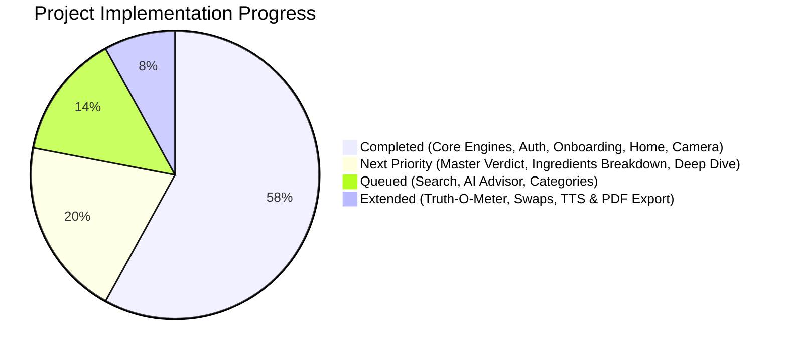
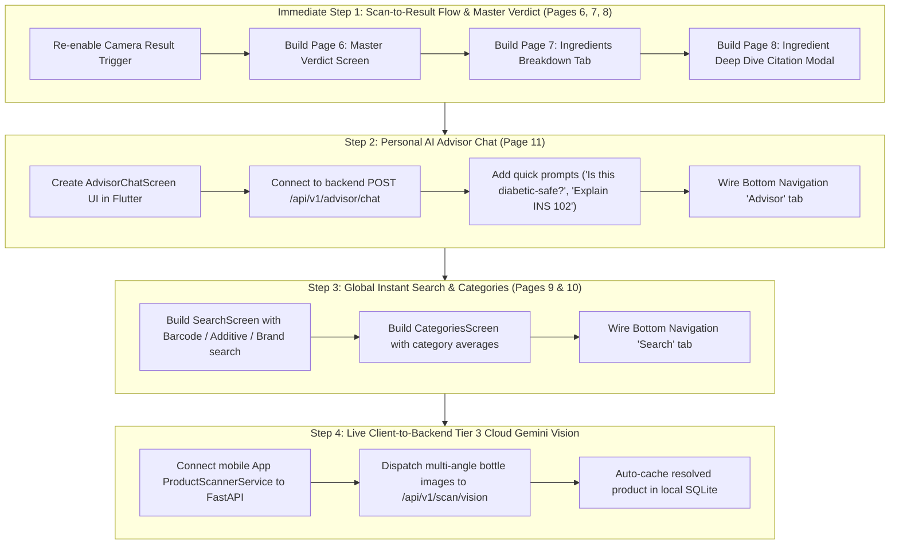

# VeriBite Project Audit & Next Steps Roadmap

> **Document Type:** Project Audit, Feature Gap Analysis & Comprehensive Next Steps Roadmap  
> **Repository:** VeriBite Smart Packaged Product Ingredient, Toxicology & Safe Consumption Dosage Scanner  
> **Date:** November 2026  
> **Current Test Status:**  
> - Flutter Mobile Suite: **107 / 107 tests passing** (0 errors in `flutter analyze`)  
> - Python Backend Suite: **66 / 66 tests passing** (Phase 1–5 Pytest gates clean)  
> - Native Android/iOS: Hardware CameraX Autofocus & Smooth Pinch-to-Zoom **operational**

---

## 1. Executive Summary: What Has Been Done vs. What Remains

We performed a deep-dive audit of the entire codebase, including all documentation (`PROJECT_SPECIFICATION.md`, `master-project-plan.md`, `README.md`, `supportive files/docs/plans/*`, and historical sprint artifacts).



### ✅ Completed & Fully Operational Modules
1. **Core Toxicology & Safe Dosage Algorithms (Backend & Mobile):**
   - Pre-bundled SQLite database with **6,450+ INS additives**, **56+ split-sweetener aliases**, and international ban matrices.
   - Deterministic **Nutri-Score calculation** with a **hard 39/100 Red-additive/trans-fat cap**.
   - **Precision Safe Consumption Dosage Engine** using WHO 20% single-snack thresholds scaled to user body weight and child sensitivity.
2. **Phase 1–5 FastAPI Cloud Gateway (`backend/`):**
   - `/api/v1/product/{barcode}`: Tier 1 barcode lookup with Open Food Facts enrichment proxy.
   - `/api/v1/scan/vision`: Tier 3 multi-angle Gemini 2.5 Flash structured extraction schema.
   - `/api/v1/advisor/chat`: Citation-grounded RAG Advisor with FSSAI/WHO/JECFA passage citation and deterministic rule fallback.
   - `/api/v1/auth`: Supabase authentication service.
3. **Mobile Onboarding & Authentication Flow (`mobile_app`):**
   - **Page 1: Starter Walkthrough & Biometrics** (`starter_walkthrough_screen.dart`, `user_details_screen.dart`): Responsive 3-step walkthrough, interactive weight slider (15–120 kg), adult/child toggle, child hyperactivity guardrail, and local SQLite persistence.
   - **Page 2 & 3: Authentication & Privacy Bypass** (`login_screen.dart`, `supabase_auth_service.dart`): Email/password, Google OAuth, and "Continue Offline Without Account" bypass.
4. **Mobile Home Dashboard (`mobile_app`):**
   - **Page 4: Home Hub** (`home_screen.dart`, `home_dashboard_service.dart`): Top biometric greeting, daily WHO safe sugar/sodium budget gauge, recent scans from SQLite, and quick-action shortcuts.
5. **Mobile Smart Camera & Hardware Optical Engine (`mobile_app`):**
   - **Page 5: Smart Camera** (`smart_camera_screen.dart`):
     - Native CameraX `SurfaceOrientedMeteringPointFactory` hardware autofocus without aspect ratio distortion.
     - Multi-touch pinch-to-zoom (1.0x to 10.0x) with ephemeral floating zoom readout badge.
     - Enlarged 320px central reticle overlay.
     - 4-angle multi-angle capture strip for cylindrical bottles.
     - Manual quick-macro slider bottom sheet.
     - Transient 1.2s pulsing visual focus ring with haptic feedback.
     - *(Note: Scan result sheet is currently temporarily suppressed via `disableResultSheet: true` as requested for optical camera testing).*

---

## 2. Master Feature Gap Analysis (Against Specification)

Below is the status of every page and core feature defined in `PROJECT_SPECIFICATION.md`:

| Screen # & Name | Category | Primary Purpose & Key Components | Status | What Needs to be Done |
| :--- | :--- | :--- | :---: | :--- |
| **Page 1: Starter Page** | Onboarding | Value walkthrough, body-weight calibrator (15–120 kg), adult/child toggle. | ✅ **Done** | Fully implemented and verified. |
| **Page 2: Login Page** | Authentication | Email/Password, Google OAuth, offline bypass. | ✅ **Done** | Fully implemented and verified. |
| **Page 3: Sign In / Details** | Profile Setup | Life-stage selection, medical guardrails, biometrics persistence. | ✅ **Done** | Fully implemented and verified. |
| **Page 4: Home Dashboard** | Dashboard | WHO budget meter, recent scans list, quick actions, bottom navigation. | ✅ **Done** | Fully implemented and verified. |
| **Page 5: Smart Camera** | Optical Engine | Hardware autofocus, pinch-to-zoom, reticle, multi-angle bottle strip. | ✅ **Done** | Autofocus & zoom verified. Need to re-enable scan trigger. |
| **Page 6: Master Verdict** | Scanner Result | Circular 0–100 gauge, serving multiplier toggle (1 Serving vs Whole Pack), safe dosage badge. | ⏳ **Next** | Expand `ScanResultSheet` into full dedicated Master Verdict view. |
| **Page 7: Ingredients Page** | Toxicology Breakdown | Split-sugar hidden sweetener cluster banner (e.g. 38% hidden sugars), safety filter chips (`All`, `Red`, `Caution`, `Safe`), color-coded cards. | ⏳ **Next** | Build the granular ingredient classification tab/screen. |
| **Page 8: Ingredients Deep Dive** | Toxicology Modal | INS expansion, chemical purpose, health risks, JECFA ADI, and verified EFSA/FSSAI citations. | ⏳ **Next** | Build the citation deep-dive modal bottom sheet. |
| **Page 9: Search Page** | Discovery | Global instant product & additive search (brand, barcode, INS code) with history. | 📋 **Queued** | Wire the bottom nav 'Search' destination to a dedicated Search Screen. |
| **Page 10: Categories Page** | Discovery | Food categories exploration grid (Biscuits, Drinks, Chips, Noodles) with health averages. | 📋 **Queued** | Build category browsing and category health benchmarks. |
| **Page 11: Personal AI Advisor** | AI Health Advisor | Conversational AI nutrition assistant powered by Gemini 2.5 Flash + Citation RAG. | 📋 **Queued** | Build chat UI in Flutter; wire to existing backend `POST /api/v1/advisor/chat`. |
| **Page 12: Profile Page** | Account & Health | View biometrics, manage family member profiles, edit safe limits. | ✅ **Done** | ProfileScreen is implemented; family sub-profiles can be extended in Phase 2. |
| **Page 13: Subscription Page** | Monetization | Free vs Premium comparison (unlimited Gemini vision, family profiles). | 📋 **Future** | Post-MVP scope. |
| **Truth-O-Meter & Swaps** | Comparative | Front-of-pack vs Back-of-pack claim auditor; 1-tap swaps to Blinkit/Zepto. | 📋 **Future** | Post-MVP Phase 6 scope. |

---

## 3. Recommended Sequential Roadmap: What to Do Next

To deliver the most immediate value while keeping the codebase clean and regression-free, here is the recommended 4-phase execution plan:



---

### Step 1: Complete Product Scan Result Flow (Pages 6, 7, and 8)
*Estimated Priority: **CRITICAL / IMMEDIATE***

Now that the camera lens autofocus and pinch-to-zoom operate flawlessly, the scan result experience should be brought to production quality matching the project specification:

1. **Re-Enable Scan Result Sheet in `smart_camera_screen.dart`:**
   - Switch `disableResultSheet` default from `true` back to `false` (or keep a toggle icon in the top action bar so the user can easily test the camera feed whenever desired).
   - Upon barcode detection, smoothly lock the reticle, trigger haptic feedback, and present the result.

2. **Build Page 6: Master Verdict Screen (`verdict_report_screen.dart`):**
   - **Circular 0–100 Health Score Gauge:** Animated canvas arc gauge with color interpolation (Green $\ge 70$, Amber $40–69$, Red $\le 39$).
   - **Strict Red Cap Indicator:** If any Red additive (e.g. Tartrazine INS 102) or trans fat is present, prominently display *"Capped at 39/100 due to Red-Tier Toxic Additive"*.
   - **Dynamic Serving Multiplier Toggle:**
     - Toggle between *"1 Serving (e.g., 20g / 2 biscuits)"* and *"Whole Packet (e.g., 90g)"*.
     - Dynamically recalculates calories, total sugars, and saturated fat displays in real-time.
   - **Prescribed Safe Consumption Portion Badge:**
     - Displays explicit portion advice: *"Max 22g (3 biscuits) per session"*.
     - Frequency Schedule pill: *Daily Safe*, *3–4x/Week*, *1–2x/Week*, or *Once a Month / Avoid*.
   - **Action Buttons:**
     - *"I Ate This (Log to Today's Sugar Budget)"* $\to$ writes to SQLite `daily_intake` and updates Home Dashboard meter.
     - *"Just Checking"* $\to$ saves to scan history without deducting from the daily budget.

3. **Build Page 7: Granular Ingredients Breakdown Tab (`ingredient_breakdown_tab.dart`):**
   - **Split-Sugar Warning Cluster:** Detects when manufacturers split sugar into multiple names (e.g., Maltodextrin, Liquid Glucose, Invert Syrup) and highlights: *"⚠️ 38% Total Hidden Sugars across 3 Sweetener Aliases"*.
   - **Filter Chips:** `All Ingredients`, `Red Flags (High Risk)`, `Caution (Amber)`, and `Safe / Clean`.
   - **Interactive Ingredient Cards:** Showing ingredient name, percentage (if declared), risk tier pill, and international ban tags (e.g., *"Banned in EU / UK"*).

4. **Build Page 8: Ingredient Deep Dive Citation Modal (`ingredient_deep_dive_sheet.dart`):**
   - Tapping any ingredient opens a deep-dive sheet containing:
     - Full chemical name & common trade names.
     - Why manufacturers use it (e.g., *"Artificial food coloring used to provide synthetic yellow hue"*).
     - Health impacts & toxicity risks (e.g., *"Associated with hyperactivity in children (Southampton study)"*).
     - Acceptable Daily Intake (ADI) scaled to the user's saved body weight.
     - **Verified Official Citations:** Exact passage quotes from FSSAI, WHO, JECFA, or EFSA.

---

### Step 2: Personal AI Nutrition Advisor Screen (Page 11)
*Estimated Priority: **HIGH***

The backend engine (`backend/api/advisor.py` and `backend/services/rag_service.py`) is already implemented and verified with 100% passing tests. The next step is building the mobile presentation layer:

1. **Build `advisor_chat_screen.dart`:**
   - Chat message list with user query bubbles and assistant response cards.
   - Grounded Citation badges below answers (e.g., `[FSSAI Compendium 2023, §4.2]`, `[EFSA Journal 2018;16(5):5262]`).
   - Quick suggested prompt pills:
     - *"Is this safe for someone with Type-2 Diabetes?"*
     - *"Why is maltodextrin worse than table sugar?"*
     - *"How much of this can my 20kg child eat safely?"*
     - *"What are the healthier swaps for this snack?"*
2. **Wire to Bottom Navigation Bar:**
   - Connect the `Advisor` icon (index 3) in `HomeScreen` to push `AdvisorChatScreen` with the user's active profile and last scanned product context.

---

### Step 3: Global Instant Search & Category Discovery (Pages 9 & 10)
*Estimated Priority: **MEDIUM***

1. **Build `search_screen.dart` (Page 9):**
   - Top search bar with debounced query execution.
   - Unified search across 3 domains:
     - **By Product Name / Brand:** (e.g., *"Good Day"*, *"Maggi"*, *"Bournvita"*).
     - **By Barcode Number:** Instant lookup.
     - **By INS / E-Number Code:** (e.g., *"INS 102"*, *"E320"*, *"Tartrazine"*).
   - Recent search query chips & clear history button.
2. **Build `categories_screen.dart` (Page 10):**
   - Grid cards for top Indian packaged food categories:
     - *Biscuits & Cookies* (Category Avg Score: 41)
     - *Chips & Namkeen* (Category Avg Score: 36)
     - *Beverages & Juices* (Category Avg Score: 32)
     - *Instant Noodles & Ready-to-Eat* (Category Avg Score: 28)
     - *Breakfast Cereals* (Category Avg Score: 52)
     - *Chocolates & Confectionery* (Category Avg Score: 26)
   - Tapping a category displays ranked products sorted from healthiest to least healthy.

---

### Step 4: Live Client-to-Backend Tier 3 Gemini Vision Integration
*Estimated Priority: **MEDIUM-HIGH***

Currently, the mobile app runs on self-contained local SQLite databases (`toxicology_master.db`), while the FastAPI backend provides cloud Gemini 2.5 Flash Vision (`/api/v1/scan/vision`).
1. Configure dynamic backend API URL in `mobile_app/lib/core/config/` (`http://10.0.2.2:8000` for Android emulator, or local LAN IP / cloud URL for physical devices).
2. When the user takes 1–4 photos of a curved bottle or crinkled pouch in `SmartCameraScreen`, upload WebP images to `/api/v1/scan/vision`.
3. Receive structured JSON extraction, execute deterministic scoring on device, and auto-cache to local SQLite so subsequent scans are instant (0.01s offline).

---

## 4. Implementation Plan for Next Session: Step-by-Step

When you are ready to begin, we recommend executing **Step 1 (Pages 6, 7, and 8)** first:

```markdown
- [ ] Task 1: Re-enable scan result presentation in SmartCameraScreen with a test-mode toggle switch
- [ ] Task 2: Create Page 6 Master Verdict Screen (`lib/features/results/presentation/verdict_report_screen.dart`)
      - Animated 0–100 circular gauge
      - 39/100 Red-cap alert banner
      - 1-Serving vs Whole-Pack dynamic nutrition multiplier toggle
      - Safe portion prescription card with frequency badge
- [ ] Task 3: Create Page 7 Ingredient Breakdown Tab (`lib/features/results/presentation/ingredient_breakdown_tab.dart`)
      - Anti-splitting hidden sugar aggregator banner
      - Safety filter chips (All / Red / Caution / Safe)
      - Color-coded ingredient cards with international ban tags
- [ ] Task 4: Create Page 8 Ingredient Deep Dive Bottom Sheet (`lib/features/results/presentation/bottom_sheets/ingredient_deep_dive_sheet.dart`)
      - Chemical purpose & health hazard explanation
      - Acceptable Daily Intake (ADI) scaled to user's body weight
      - Official citations from WHO, FSSAI, JECFA, EFSA
- [ ] Task 5: Run full verification suite (`flutter analyze` + `flutter test`) and commit to main
```

---

*This document is saved as `NEXT_STEPS_ROADMAP.md` in the workspace root for reference.*
