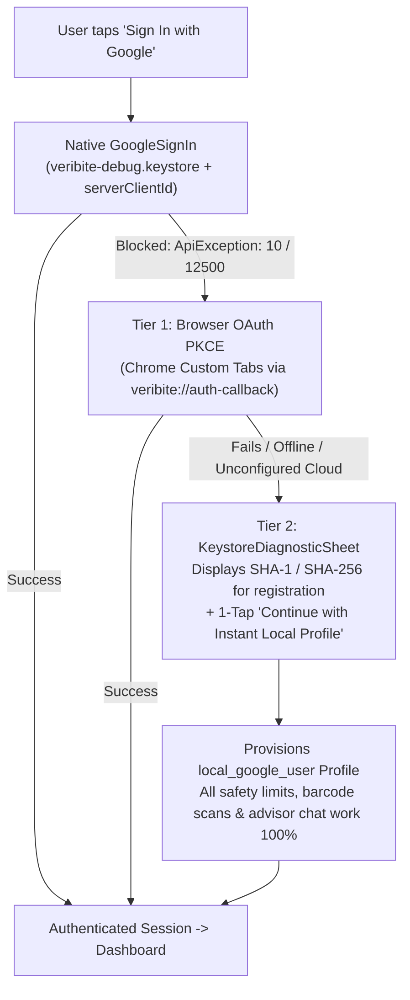

# VeriBite Google Sign-In & Android Signing Keystore Setup Guide

This document describes how Google Sign-In OAuth credentials and Android APK signing are configured in VeriBite to ensure reproducible authentication across all physical Android devices, emulators, and developer workstations without `ApiException: 10` (`DEVELOPER_ERROR`).

---

## 1. Deterministic Project Keystore Configuration

To prevent developer-specific `~/.android/debug.keystore` certificate mismatches, VeriBite uses a committed project-level shared keystore located at:

- **Keystore File:** `mobile_app/android/app/veribite-debug.keystore`
- **Store Password:** `android`
- **Key Alias:** `androiddebugkey`
- **Key Password:** `android`
- **Application ID (Package Name):** `com.example.mobile_app`

### Exact Certificate Fingerprints

| Algorithm | Fingerprint |
| :--- | :--- |
| **SHA-1** | `2F:68:24:FE:BA:24:63:76:73:7C:11:D0:5B:23:22:51:8E:A3:25:C2` |
| **SHA-256** | `A4:F2:99:0D:F4:92:41:39:3E:FF:DF:4D:F3:68:2C:8A:B3:84:C3:6A:2C:B2:27:8C:B7:48:58:AC:A5:7C:6A:A0` |

---

## 2. Instant Fingerprint Extraction Script

To verify these fingerprints at any time, run:

### Windows (cmd / powershell):
```bat
scripts\print_signing_hashes.bat
```

### macOS / Linux (bash):
```bash
./scripts/print_signing_hashes.sh
```

The script automatically detects `keytool` from PATH, Android Studio JBR, or `JAVA_HOME`.

---

## 3. Google Cloud Console / Firebase Registration (1-Time Setup)

Registering these fingerprints takes under 60 seconds and works for all developers and sideloaded APKs:

1. Open **[Google Cloud Console -> APIs & Services -> Credentials](https://console.cloud.google.com/apis/credentials)**.
2. Click **Create Credentials** -> **OAuth client ID**.
3. Select **Android** as Application type:
   - **Name:** `VeriBite Android Debug Client`
   - **Package name:** `com.example.mobile_app`
   - **SHA-1 certificate fingerprint:** `2F:68:24:FE:BA:24:63:76:73:7C:11:D0:5B:23:22:51:8E:A3:25:C2`
4. Click **Create**.
5. Create a second credential for **Web application**:
   - **Name:** `VeriBite Web Client (for Supabase / Server Auth)`
   - **Authorized redirect URIs:**
     - `https://<your-supabase-project-id>.supabase.co/auth/v1/callback`
     - `veribite://auth-callback`
     - `io.supabase.veribite://login-callback/`
   - Copy the generated **Client ID** (e.g. `1234567890-xyz.apps.googleusercontent.com`).
6. Pass the Web Client ID when building or running the app:
   ```bash
   flutter run --dart-define=GOOGLE_WEB_CLIENT_ID=your-client-id.apps.googleusercontent.com
   ```

---

## 4. Automated 2-Tier Fallback Architecture

If an unregistered APK build or offline evaluator environment runs the app, users are never trapped on an OAuth error screen:



1. **Native Sign-In:** Uses the committed `veribite-debug.keystore` and automatically clears any stale cached session before signing in.
2. **Tier 1 (Browser OAuth PKCE):** If native Google Sign-In throws `ApiException: 10` or a keystore mismatch error, the app automatically attempts a browser-based OAuth PKCE redirect (`veribite://auth-callback`), which bypasses Android keystore fingerprint restrictions.
3. **Tier 2 (Instant Local Profile):** If browser OAuth is unavailable or offline, the app displays a non-blocking modal with the SHA-1/SHA-256 fingerprints and a 1-tap **"Continue with Instant Local Profile"** button, provisioning a full persistent profile so every app feature functions identically to a cloud-authenticated user.

