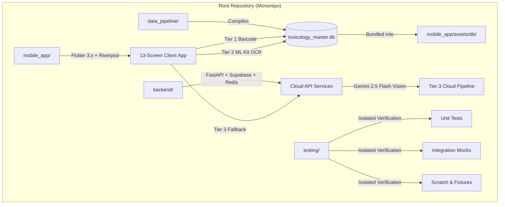

# Phase 1 Implementation Plan: Monorepo Architecture, Environment & Toolchain Initialization

> **For agentic workers:** REQUIRED SUB-SKILL: Use `superpowers:subagent-driven-development` to implement this plan task-by-task. Steps use checkbox (`- [ ]`) syntax for tracking.
> 
> **Governance:** Strict adherence to [`rules/01-ponytail.md`](file:///c:/yash/projects/first%20mobile%20app/rules/01-ponytail.md), [`rules/02-testing-folder.md`](file:///c:/yash/projects/first%20mobile%20app/rules/02-testing-folder.md), [`rules/03-architecture-and-techstack.md`](file:///c:/yash/projects/first%20mobile%20app/rules/03-architecture-and-techstack.md), and [`rules/05-execution-approval-gate.md`](file:///c:/yash/projects/first%20mobile%20app/rules/05-execution-approval-gate.md).

**Goal:** Establish a clean, reproducible monorepo workspace separating data compilation (`data_pipeline/`), cloud API services (`backend/`), cross-platform mobile client (`mobile_app/`), and strictly isolated testing infrastructure (`testing/`), matching the Master Engineering Blueprint and native platform fallback specifications.

**Architecture:** A unified monorepo hosting three independent layers:
1. `data_pipeline/` for offline SQLite FTS5 database compilation,
2. `backend/` for FastAPI, Supabase PostgreSQL, Redis caching, and Gemini 2.5 Flash vision RAG,
3. `mobile_app/` for Flutter 3.x cross-platform mobile client with Riverpod reactive state management and GoRouter navigation.
All temporary scripts, mock fixtures, and unit test suites are isolated inside `testing/` with zero production source pollution.

**Architecture Diagram:**



**Tech Stack:**
- **Python Backend & Data Pipeline:** Python 3.13 (`uv` package manager), FastAPI, Uvicorn, Pydantic v2, Google GenAI SDK, Supabase, Redis, Pytest.
- **Cross-Platform Mobile:** Flutter 3.x (Dart 3.x), `flutter_riverpod`, `go_router`, `sqflite`, `sqlite3_flutter_libs` (FTS5 enabled), `mobile_scanner`, `google_mlkit_text_recognition`, `flutter_tts`, `pdf`, `printing`.
- **Test Infrastructure:** Pytest test suites strictly residing in `testing/unit/phase1/`.
- **Master Specification:** [`Master Execution Plan, Wireframe Audit & Fallback Specification.pdf`](file:///c:/Users/Yash%20chougule/Downloads/Master%20Execution%20Plan,%20Wireframe%20Audit%20&%20Fallback%20Specification.pdf).

---

## Global Constraints

- **Compulsory Ponytail Protocol:** Minimum working code, stdlib first, zero unrequested abstractions, diffs < 100 lines per focused unit.
- **Strict Testing Directory Isolation:** All test scripts, mock datasets, scratch scripts, and diagnostic verification runners must strictly reside inside `testing/`. Zero test code in production trees.
- **Native Fallback Guardrails:**
  - *SQLite FTS5 Fallback:* Ensure `sqlite3_flutter_libs` is pinned to bundle compiled C SQLite with FTS5 and trigram tokenizer pre-enabled on older Android OEM ROMs.
  - *ML Kit Offline Model Fallback:* Scaffold static asset path `mobile_app/android/app/src/main/assets/mlkit/` for Latin OCR fallback over metered networks.
  - *Single-Camera Unified Controller:* Architecture contract preventing camera hardware locking between `mobile_scanner` and OCR streams.
- **Strict Plan Execution Approval Gate:** No production code, scaffolding commands, or package installations will be executed until explicit user confirmation is received.

---

## User Review Required

> [!IMPORTANT]
> **Toolchain Verification:** `uv` (version 0.11.28) and Python 3.13 are verified available on this host. For Flutter, `mobile_app/` will be structured declaratively with pinned `pubspec.yaml`, analysis options, and fallback contracts, allowing seamless sync with Flutter 3.x SDK.
> 
> **Testing Isolation:** All verification tests for Phase 1 will execute via `pytest testing/unit/phase1/` using zero external network calls.

---

## Proposed Changes & Task Breakdown

### Component 1: Monorepo Directory Architecture & Workspace Sanitation

#### [NEW] `data_pipeline/README.md`
#### [NEW] `backend/README.md`
#### [NEW] `mobile_app/README.md`
#### [NEW] `testing/unit/phase1/test_workspace_layout.py`
#### [MODIFY] `.gitignore`
#### [NEW] `README.md`

---

### Task 1: Monorepo Foundation & Directory Structuring

**Files:**
- Create: `data_pipeline/README.md`
- Create: `backend/README.md`
- Create: `mobile_app/README.md`
- Create: `testing/unit/phase1/test_workspace_layout.py`
- Modify: `.gitignore`
- Create: `README.md`

**Interfaces:**
- Consumes: Host filesystem layout.
- Produces: Normalized monorepo tree containing `data_pipeline/`, `backend/`, `mobile_app/`, `testing/`, and clean `.gitignore` ignoring virtualenvs, build artifacts, and test scratch.

- [ ] **Step 1: Write the failing test for monorepo layout**

```python
# testing/unit/phase1/test_workspace_layout.py
from pathlib import Path

def test_monorepo_top_level_directories_exist():
    workspace = Path(__file__).resolve().parents[3]
    required_dirs = [
        workspace / "data_pipeline",
        workspace / "backend",
        workspace / "mobile_app",
        workspace / "testing" / "unit" / "phase1",
        workspace / "testing" / "integration",
        workspace / "testing" / "fixtures",
        workspace / "testing" / "scratch",
    ]
    for directory in required_dirs:
        assert directory.is_dir(), f"Required directory missing: {directory}"

def test_gitignore_covers_python_flutter_and_test_artifacts():
    workspace = Path(__file__).resolve().parents[3]
    gitignore_path = workspace / ".gitignore"
    assert gitignore_path.is_file(), ".gitignore does not exist"
    content = gitignore_path.read_text(encoding="utf-8")
    required_patterns = [
        ".venv",
        "__pycache__",
        "*.pyc",
        ".dart_tool",
        "build/",
        "testing/scratch/*.db",
        ".env",
    ]
    for pattern in required_patterns:
        assert pattern in content, f"Missing pattern in .gitignore: {pattern}"
```

- [ ] **Step 2: Run test to verify it fails**

Run: `uv run pytest testing/unit/phase1/test_workspace_layout.py -v`
Expected: FAIL (missing directories and gitignore patterns).

- [ ] **Step 3: Implement minimal directory structure and update `.gitignore`**

Create directory trees and append required patterns to `.gitignore`:

```diff
# .gitignore
+ # Python Virtual Environments & Bytecode
+ .venv/
+ __pycache__/
+ *.pyc
+ *.pyo
+ 
+ # Flutter & Dart Build Artifacts
+ .dart_tool/
+ .flutter-plugins
+ .flutter-plugins-dependencies
+ .packages
+ build/
+ 
+ # Test Scratch & Local Databases
+ testing/scratch/*
+ !testing/scratch/.gitkeep
+ *.db-journal
+ *.db-wal
+ 
+ # Secrets & Local Environment
+ .env
+ .env.local
+ .env.test
```

Create placeholder `README.md` files in `data_pipeline/`, `backend/`, and `mobile_app/`.

- [ ] **Step 4: Run test to verify it passes**

Run: `uv run pytest testing/unit/phase1/test_workspace_layout.py -v`
Expected: PASS

- [ ] **Step 5: Commit**

```bash
git add .gitignore README.md data_pipeline/ backend/ mobile_app/ testing/
git commit -m "chore: initialize monorepo directory layout and gitignore"
```

---

### Component 2: Backend & Data Pipeline Toolchain Initialization

#### [NEW] `backend/pyproject.toml`
#### [NEW] `backend/main.py`
#### [NEW] `data_pipeline/pyproject.toml`
#### [NEW] `testing/unit/phase1/test_backend_toolchain.py`

---

### Task 2: Backend Dependency Pinning & Hermetic Virtualenv Setup

**Files:**
- Create: `backend/pyproject.toml`
- Create: `backend/main.py`
- Create: `data_pipeline/pyproject.toml`
- Create: `testing/unit/phase1/test_backend_toolchain.py`

**Interfaces:**
- Consumes: Python 3.13 and `uv` package manager.
- Produces: Hermetic `.venv` with `fastapi`, `uvicorn`, `google-genai`, `supabase`, `redis`, `httpx`, `pydantic`, `pytest`, and a working `/health` endpoint.

- [ ] **Step 1: Write the failing test for backend dependencies and health contract**

```python
# testing/unit/phase1/test_backend_toolchain.py
import pytest
from fastapi.testclient import TestClient

def test_required_backend_modules_importable():
    import fastapi
    import uvicorn
    import pydantic
    import httpx
    assert fastapi.__version__
    assert pydantic.__version__

def test_backend_health_endpoint():
    from backend.main import app
    client = TestClient(app)
    response = client.get("/health")
    assert response.status_code == 200
    data = response.json()
    assert data["status"] == "ok"
    assert "version" in data
```

- [ ] **Step 2: Run test to verify it fails**

Run: `uv run pytest testing/unit/phase1/test_backend_toolchain.py -v`
Expected: FAIL with ModuleNotFoundError or import error.

- [ ] **Step 3: Define `backend/pyproject.toml` and implement `backend/main.py`**

```toml
# backend/pyproject.toml
[project]
name = "packaged-food-scanner-backend"
version = "0.1.0"
description = "FastAPI backend, Supabase client, Redis cache & Gemini 2.5 Flash Vision RAG services"
requires-python = ">=3.11"
dependencies = [
    "fastapi>=0.115.0",
    "uvicorn[standard]>=0.32.0",
    "pydantic>=2.10.0",
    "httpx>=0.28.0",
    "google-genai>=0.1.0",
    "supabase>=2.10.0",
    "redis>=5.2.0",
    "pytest>=8.3.0",
]

[build-system]
requires = ["hatchling"]
build-backend = "hatchling.build"
```

```python
# backend/main.py
from fastapi import FastAPI

app = FastAPI(
    title="Smart Packaged Product Scanner API",
    version="1.0.0",
    description="Backend services for barcode resolution, Gemini 2.5 Flash vision extraction, and citation RAG"
)

@app.get("/health")
def health_check():
    # ponytail: minimal health probe, expand when database ping is wired
    return {"status": "ok", "version": "1.0.0", "phase": 1}
```

Run `uv pip install -e backend/` or `uv venv` to lock and install dependencies.

- [ ] **Step 4: Run test to verify it passes**

Run: `uv run pytest testing/unit/phase1/test_backend_toolchain.py -v`
Expected: PASS

- [ ] **Step 5: Commit**

```bash
git add backend/ data_pipeline/ testing/unit/phase1/
git commit -m "feat(backend): configure pyproject dependencies and health probe"
```

---

### Component 3: Flutter Mobile App Configuration & Package Specification

#### [NEW] `mobile_app/pubspec.yaml`
#### [NEW] `mobile_app/analysis_options.yaml`
#### [NEW] `mobile_app/lib/main.dart`
#### [NEW] `testing/unit/phase1/test_flutter_pubspec.py`

---

### Task 3: Flutter Package Configuration & Declarative Structure

**Files:**
- Create: `mobile_app/pubspec.yaml`
- Create: `mobile_app/analysis_options.yaml`
- Create: `mobile_app/lib/main.dart`
- Create: `testing/unit/phase1/test_flutter_pubspec.py`

**Interfaces:**
- Consumes: Blueprint section 3 (Phase 1 Flutter Package Configuration).
- Produces: Fully configured `pubspec.yaml` pinning all required offline, camera, speech, and export packages.

- [ ] **Step 1: Write the failing test for `pubspec.yaml` package specification**

```python
# testing/unit/phase1/test_flutter_pubspec.py
from pathlib import Path
import yaml

def test_flutter_pubspec_contains_all_blueprint_dependencies():
    workspace = Path(__file__).resolve().parents[3]
    pubspec_path = workspace / "mobile_app" / "pubspec.yaml"
    assert pubspec_path.is_file(), "mobile_app/pubspec.yaml not found"
    
    with open(pubspec_path, "r", encoding="utf-8") as f:
        data = yaml.safe_load(f)
        
    deps = data.get("dependencies", {})
    required_packages = [
        "flutter",
        "flutter_riverpod",
        "go_router",
        "sqflite",
        "sqlite3_flutter_libs",
        "mobile_scanner",
        "google_mlkit_text_recognition",
        "image",
        "flutter_tts",
        "url_launcher",
        "pdf",
        "printing",
    ]
    for pkg in required_packages:
        assert pkg in deps, f"Required dependency missing from pubspec.yaml: {pkg}"
```

- [ ] **Step 2: Run test to verify it fails**

Run: `uv run pytest testing/unit/phase1/test_flutter_pubspec.py -v`
Expected: FAIL (missing `pubspec.yaml`).

- [ ] **Step 3: Create `mobile_app/pubspec.yaml` and entry point `mobile_app/lib/main.dart`**

```yaml
# mobile_app/pubspec.yaml
name: mobile_app
description: Smart Packaged Product Ingredient, Toxicology & Safe Consumption Dosage Scanner
publish_to: 'none'
version: 1.0.0+1

environment:
  sdk: '>=3.2.0 <4.0.0'

dependencies:
  flutter:
    sdk: flutter
  flutter_riverpod: ^2.6.1
  go_router: ^14.6.2
  sqflite: ^2.4.1
  sqlite3_flutter_libs: ^0.5.24
  mobile_scanner: ^6.0.2
  google_mlkit_text_recognition: ^0.13.0
  image: ^4.3.0
  flutter_tts: ^4.2.0
  url_launcher: ^6.3.1
  pdf: ^3.11.1
  printing: ^5.13.2

dev_dependencies:
  flutter_test:
    sdk: flutter
  flutter_lints: ^5.0.0

flutter:
  uses-material-design: true
  assets:
    - assets/db/
    - assets/mlkit/
```

```dart
// mobile_app/lib/main.dart
import 'package:flutter/material.dart';
import 'package:flutter_riverpod/flutter_riverpod.dart';

void main() {
  // ponytail: entry point with Riverpod ProviderScope, GoRouter routes wired in Phase 6
  runApp(const ProviderScope(child: ScannerApp()));
}

class ScannerApp extends StatelessWidget {
  const ScannerApp({super.key});

  @override
  Widget build(BuildContext context) {
    return MaterialApp(
      title: 'Packaged Product Safety Scanner',
      theme: ThemeData(
        colorScheme: ColorScheme.fromSeed(seedColor: const Color(0xFF0F9D58)),
        useMaterial3: true,
      ),
      home: const Scaffold(
        body: Center(
          child: Text('Safe Consumption Dosage Scanner Initialized'),
        ),
      ),
    );
  }
}
```

- [ ] **Step 4: Run test to verify it passes**

Run: `uv run pytest testing/unit/phase1/test_flutter_pubspec.py -v`
Expected: PASS

- [ ] **Step 5: Commit**

```bash
git add mobile_app/ testing/unit/phase1/
git commit -m "feat(mobile_app): scaffold Flutter pubspec and entry point"
```

---

### Component 4: Native Fallback Specifications & Infrastructure Contracts

#### [NEW] `mobile_app/android/app/src/main/assets/mlkit/.gitkeep`
#### [NEW] `mobile_app/lib/core/contracts/camera_stream_contract.dart`
#### [NEW] `mobile_app/lib/core/database/fts5_resilience_contract.dart`
#### [NEW] `testing/unit/phase1/test_native_fallbacks.py`

---

### Task 4: Native Plugin Fallbacks & Single-Camera Architecture Contract

**Files:**
- Create: `mobile_app/android/app/src/main/assets/mlkit/.gitkeep`
- Create: `mobile_app/lib/core/contracts/camera_stream_contract.dart`
- Create: `mobile_app/lib/core/database/fts5_resilience_contract.dart`
- Create: `testing/unit/phase1/test_native_fallbacks.py`

**Interfaces:**
- Consumes: Blueprint Section 3 (Phase 1 Fallback System: FTS5 bundled C binary, ML Kit static offline model asset path, and single-camera frame stream contract).
- Produces: Concrete architectural contracts ensuring zero hardware sensor collision and offline model resilience.

- [ ] **Step 1: Write the failing test for native fallback contracts and assets**

```python
# testing/unit/phase1/test_native_fallbacks.py
from pathlib import Path

def test_mlkit_static_asset_fallback_directory_exists():
    workspace = Path(__file__).resolve().parents[3]
    mlkit_dir = workspace / "mobile_app" / "android" / "app" / "src" / "main" / "assets" / "mlkit"
    assert mlkit_dir.is_dir(), f"Static ML Kit fallback directory missing: {mlkit_dir}"

def test_camera_stream_contract_defines_unified_pipeline():
    workspace = Path(__file__).resolve().parents[3]
    contract = workspace / "mobile_app" / "lib" / "core" / "contracts" / "camera_stream_contract.dart"
    assert contract.is_file(), "Camera stream contract missing"
    content = contract.read_text(encoding="utf-8")
    assert "CameraFrameStream" in content
    assert "onBarcodeDetected" in content
    assert "onTextRecognized" in content
```

- [ ] **Step 2: Run test to verify it fails**

Run: `uv run pytest testing/unit/phase1/test_native_fallbacks.py -v`
Expected: FAIL

- [ ] **Step 3: Implement fallback contracts and directory structure**

```dart
// mobile_app/lib/core/contracts/camera_stream_contract.dart
import 'dart:typed_data';

/// Unified single-camera frame stream to prevent hardware lock between
/// barcode scanning and ML Kit OCR recognition (Phase 1 Fallback Specification).
abstract class UnifiedCameraStreamContract {
  Stream<Uint8List> get cameraFrameStream;
  void onBarcodeDetected(String barcode);
  void onTextRecognized(String rawOcrText);
  Future<void> setTorchMode(bool enabled);
}
```

```dart
// mobile_app/lib/core/database/fts5_resilience_contract.dart
/// Contract ensuring SQLite FTS5 with trigram tokenization is validated
/// on-device before querying, falling back to bundled sqlite3_flutter_libs C binary.
abstract class FTS5ResilienceContract {
  Future<bool> verifyFTS5Available();
  Future<void> initializeWithFallback();
}
```

- [ ] **Step 4: Run test to verify it passes**

Run: `uv run pytest testing/unit/phase1/test_native_fallbacks.py -v`
Expected: PASS

- [ ] **Step 5: Commit**

```bash
git add mobile_app/ android/ testing/unit/phase1/
git commit -m "feat(mobile_app): add native fallback contracts and ML Kit static asset directory"
```

---

### Component 5: Phase 1 Release Gate & End-to-End Verification

#### [NEW] `testing/unit/phase1/test_phase1_gate.py`

---

### Task 5: End-to-End Phase 1 Release Gate Suite

**Files:**
- Create: `testing/unit/phase1/test_phase1_gate.py`

**Interfaces:**
- Consumes: All Phase 1 deliverables (Task 1 to Task 4).
- Produces: Deterministic passing test run proving Phase 1 completeness before Phase 2 begins.

- [ ] **Step 1: Write the Phase 1 master release gate test**

```python
# testing/unit/phase1/test_phase1_gate.py
from pathlib import Path
from fastapi.testclient import TestClient

def test_phase_1_full_toolchain_gate():
    workspace = Path(__file__).resolve().parents[3]
    
    # 1. Monorepo directories
    for d in ["data_pipeline", "backend", "mobile_app", "testing"]:
        assert (workspace / d).is_dir(), f"Missing core dir: {d}"
        
    # 2. Backend health endpoint
    from backend.main import app
    client = TestClient(app)
    res = client.get("/health")
    assert res.status_code == 200
    assert res.json()["phase"] == 1
    
    # 3. Mobile pubspec integrity
    pubspec = (workspace / "mobile_app" / "pubspec.yaml").read_text(encoding="utf-8")
    assert "sqlite3_flutter_libs" in pubspec
    assert "mobile_scanner" in pubspec
    
    # 4. Strict testing isolation
    # Ensure no *.py test files exist inside backend/ or mobile_app/
    backend_tests = list((workspace / "backend").glob("**/test_*.py"))
    assert len(backend_tests) == 0, f"Pollution in backend: {backend_tests}"
```

- [ ] **Step 2: Run test to verify it passes**

Run: `uv run pytest testing/unit/phase1/test_phase1_gate.py -v`
Expected: PASS (all gate checks succeed).

- [ ] **Step 3: Commit Phase 1 completion**

```bash
git add testing/unit/phase1/test_phase1_gate.py
git commit -m "test(phase1): add comprehensive release gate verification"
```

---

## Verification Plan

### Automated Tests
Run the entire Phase 1 unit verification suite using `uv`:
```bash
uv run pytest testing/unit/phase1/ -v
```
All tests must execute in < 2 seconds with 0 failures and 0 network calls.

### Manual Verification
1. Inspect file tree in terminal:
   `Get-ChildItem -Directory` displays `backend`, `data_pipeline`, `docs`, `mobile_app`, `rules`, `testing`.
2. Verify backend probe:
   Run `uv run uvicorn backend.main:app --port 8000` and query `http://127.0.0.1:8000/health`.
3. Verify test hygiene:
   Verify `backend/` and `mobile_app/` contain zero scratch or test runner files.
