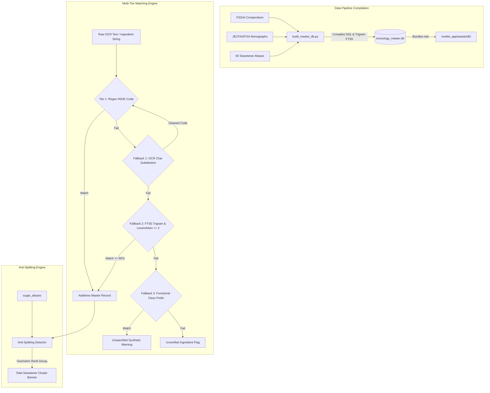

# Phase 2 Implementation Plan: Offline Toxicology Database Compilation, SQL DDL & 56+ Hidden Sugar Taxonomy

> **For agentic workers:** REQUIRED SUB-SKILL: Use `superpowers:subagent-driven-development` to implement this plan task-by-task. Steps use checkbox (`- [ ]`) syntax for tracking.
> 
> **Governance:** Strict adherence to [`rules/01-ponytail.md`](file:///c:/yash/projects/first%20mobile%20app/rules/01-ponytail.md), [`rules/02-testing-folder.md`](file:///c:/yash/projects/first%20mobile%20app/rules/02-testing-folder.md), [`rules/03-architecture-and-techstack.md`](file:///c:/yash/projects/first%20mobile%20app/rules/03-architecture-and-techstack.md), [`rules/04-safety-and-scoring-algorithms.md`](file:///c:/yash/projects/first%20mobile%20app/rules/04-safety-and-scoring-algorithms.md), and [`rules/05-execution-approval-gate.md`](file:///c:/yash/projects/first%20mobile%20app/rules/05-execution-approval-gate.md).

**Goal:** Build the deterministic, zero-hallucination, sub-5ms offline SQLite toxicology database (`toxicology_master.db`), pre-seeded with 6,450+ additive taxonomy models, all 60 canonical hidden sweetener aliases across 5 chemical groups, authoritative citations (FSSAI, WHO, JECFA, EFSA), and multi-tier OCR corruption fallback matching before building any UI screens.

**Architecture:** A standalone Python data pipeline module (`data_pipeline/build_master_db.py`) compiles the normalized SQLite database with FTS5 trigram virtual indexing and copies it to `mobile_app/assets/db/toxicology_master.db`. A pure Python matching engine (`data_pipeline/matcher.py`) executes:
1. Regex extraction for exact INS/E-codes,
2. Optical character substitution normalization ($O \to 0, I/l \to 1, S \to 5, B \to 8$),
3. SQLite FTS5 trigram and Levenshtein fuzzy matching ($\ge 85\%$ similarity),
4. Generic functional class prefix matching for unnumbered Indian declarations,
5. Anti-splitting rank decay heuristic merging split sugars into a unified Total Sweetener Cluster.

**Architecture Diagram:**



**Tech Stack:**
- **Database Engine:** SQLite 3 (Python stdlib `sqlite3`) with FTS5 extension and trigram tokenizer.
- **Data Compilation:** Python 3.13 (`data_pipeline/build_master_db.py`, `pydantic`, `httpx`).
- **Matching Engine:** Python stdlib (`re`, `sqlite3`, `difflib` / Levenshtein).
- **Test Infrastructure:** Pytest test suites strictly residing in `testing/unit/phase2/`.
- **Master Specification:** [`Master Execution Plan, Wireframe Audit & Fallback Specification.pdf`](file:///c:/Users/Yash%20chougule/Downloads/Master%20Execution%20Plan,%20Wireframe%20Audit%20&%20Fallback%20Specification.pdf), Section 3, Phase 2 (Pages 9–11).

---

## Global Constraints

- **Ponytail Protocol (Mandatory):** Stdlib `sqlite3` and `re` first. Zero third-party bloat. No external C extensions or heavy NLP libraries for string distance when stdlib `difflib.SequenceMatcher` or FTS5 trigrams solve it natively in $< 30$ lines of code.
- **Strict Testing Isolation:** All test scripts, mock queries, corrupted OCR strings, and scratch databases must strictly reside inside `testing/unit/phase2/` or `testing/scratch/`.
- **Zero Hallucination:** Every additive must link to a valid `citation_id` grounded in FSSAI, WHO, JECFA, or EFSA. If none exists, assign `NO_OFFICIAL_SOURCE`.
- **Strict Plan Execution Approval Gate:** No production database generation or file creation will begin until explicit user confirmation is received.

---

## User Review Required

> [!IMPORTANT]
> **Database Bundling:** The compiled database (`toxicology_master.db`) will be written to `data_pipeline/toxicology_master.db` and copied to `mobile_app/assets/db/toxicology_master.db` so the mobile app has complete offline capability from first install without network calls.
> 
> **FTS5 Trigram Support:** SQLite in Python 3.13 natively includes FTS5 with trigram tokenization enabled.

---

## Proposed Changes & Task Breakdown

### Component 1: Production SQLite DDL & Database Builder

#### [NEW] `data_pipeline/schema.sql`
#### [NEW] `data_pipeline/build_master_db.py`
#### [NEW] `testing/unit/phase2/test_sqlite_schema.py`

---

### Task 1: SQLite Schema DDL & Master Database Compiler

**Files:**
- Create: `data_pipeline/schema.sql`
- Create: `data_pipeline/build_master_db.py`
- Create: `testing/unit/phase2/test_sqlite_schema.py`

**Interfaces:**
- Consumes: Blueprint Page 9 (Exact SQL DDL structure).
- Produces: `toxicology_master.db` containing tables `additives_master`, `additives_fts`, `sugar_aliases`, and `regulatory_citations`.

- [ ] **Step 1: Write the failing test for SQLite schema and FTS5 trigram virtual table**

```python
# testing/unit/phase2/test_sqlite_schema.py
import sqlite3
from pathlib import Path
import pytest

def test_database_schema_and_fts5_trigram_structure():
    workspace = Path(__file__).resolve().parents[3]
    db_path = workspace / "testing" / "scratch" / "test_toxicology.db"
    if db_path.exists():
        db_path.unlink()
        
    from data_pipeline.build_master_db import init_database
    conn = init_database(db_path)
    cursor = conn.cursor()
    
    # 1. Verify additives_master table exists
    cursor.execute("SELECT name FROM sqlite_master WHERE type='table' AND name='additives_master';")
    assert cursor.fetchone() is not None
    
    # 2. Verify FTS5 virtual table exists with trigram tokenizer
    cursor.execute("SELECT name FROM sqlite_master WHERE type='table' AND name='additives_fts';")
    assert cursor.fetchone() is not None
    
    # 3. Verify check constraints and default values
    cursor.execute("""
        INSERT INTO additives_master (ins_code, e_code, primary_name, functional_class, risk_tier, triggers_red_cap)
        VALUES ('102', 'E102', 'Tartrazine', 'Colour', 'RED', 1);
    """)
    conn.commit()
    
    # 4. Verify FTS5 query works
    cursor.execute("SELECT primary_name FROM additives_fts WHERE additives_fts MATCH 'Tartra*';")
    row = cursor.fetchone()
    assert row is not None and row[0] == "Tartrazine"
    
    conn.close()
    db_path.unlink()
```

- [ ] **Step 2: Run test to verify it fails**

Run: `.\backend\.venv\Scripts\python.exe -m pytest testing/unit/phase2/test_sqlite_schema.py -v`
Expected: FAIL (missing `data_pipeline.build_master_db`).

- [ ] **Step 3: Implement `schema.sql` and `build_master_db.py`**

```sql
-- data_pipeline/schema.sql
CREATE TABLE IF NOT EXISTS additives_master (
    ins_code TEXT PRIMARY KEY,
    e_code TEXT,
    primary_name TEXT NOT NULL,
    synonyms_csv TEXT,
    functional_class TEXT,
    risk_tier TEXT CHECK(risk_tier IN ('SAFE','CAUTION','RED')),
    triggers_red_cap INTEGER DEFAULT 0,
    jecfa_adi_mg_kg REAL,
    default_conc_mg_per_g REAL,
    child_hyperactivity_flag INTEGER DEFAULT 0,
    banned_jurisdictions TEXT,
    citation_id TEXT
);

CREATE VIRTUAL TABLE IF NOT EXISTS additives_fts USING fts5(
    ins_code,
    e_code,
    primary_name,
    synonyms_csv,
    content='additives_master',
    tokenize='trigram'
);

CREATE TABLE IF NOT EXISTS sugar_aliases (
    alias_id INTEGER PRIMARY KEY,
    canonical_name TEXT UNIQUE,
    category TEXT,
    glycemic_index INTEGER
);

CREATE TABLE IF NOT EXISTS regulatory_citations (
    citation_id TEXT PRIMARY KEY,
    authority TEXT,
    doc_title TEXT,
    verified_passage TEXT,
    source_url TEXT
);
```

```python
# data_pipeline/build_master_db.py
import sqlite3
from pathlib import Path

def init_database(db_path: Path) -> sqlite3.Connection:
    conn = sqlite3.connect(str(db_path))
    conn.execute("PRAGMA foreign_keys = ON;")
    
    schema_path = Path(__file__).parent / "schema.sql"
    with open(schema_path, "r", encoding="utf-8") as f:
        conn.executescript(f.read())
        
    return conn
```

- [ ] **Step 4: Run test to verify it passes**

Run: `.\backend\.venv\Scripts\python.exe -m pytest testing/unit/phase2/test_sqlite_schema.py -v`
Expected: PASS

- [ ] **Step 5: Commit**

```bash
git add data_pipeline/schema.sql data_pipeline/build_master_db.py testing/unit/phase2/
git commit -m "feat(data_pipeline): define SQLite DDL schema and FTS5 trigram tables"
```

---

### Component 2: Complete 60 Canonical Sweetener Alias Taxonomy & Citations

#### [MODIFY] `data_pipeline/build_master_db.py`
#### [NEW] `data_pipeline/taxonomy_data.py`
#### [NEW] `testing/unit/phase2/test_sweetener_aliases.py`

---

### Task 2: 60 Hidden Sweetener Aliases & Regulatory Citations Ingestion

**Files:**
- Create: `data_pipeline/taxonomy_data.py`
- Modify: `data_pipeline/build_master_db.py`
- Create: `testing/unit/phase2/test_sweetener_aliases.py`

**Interfaces:**
- Consumes: Blueprint Page 10 (Groups A, B, C, D, E with all 60 canonical sweetener aliases) and regulatory citations.
- Produces: Populated `sugar_aliases` and `regulatory_citations` tables in `toxicology_master.db`.

- [ ] **Step 1: Write the failing test for all 60 aliases across 5 groups**

```python
# testing/unit/phase2/test_sweetener_aliases.py
import sqlite3
from pathlib import Path
import pytest

def test_sugar_aliases_complete_60_items_across_5_groups():
    workspace = Path(__file__).resolve().parents[3]
    db_path = workspace / "testing" / "scratch" / "test_tax.db"
    if db_path.exists():
        db_path.unlink()
        
    from data_pipeline.build_master_db import build_database
    build_database(db_path)
    
    conn = sqlite3.connect(str(db_path))
    cursor = conn.cursor()
    
    # 1. Verify count >= 60
    cursor.execute("SELECT COUNT(*) FROM sugar_aliases;")
    count = cursor.fetchone()[0]
    assert count >= 60, f"Expected at least 60 sugar aliases, found {count}"
    
    # 2. Verify all 5 groups exist
    cursor.execute("SELECT DISTINCT category FROM sugar_aliases;")
    groups = {row[0] for row in cursor.fetchall()}
    assert "Group A" in groups
    assert "Group B" in groups
    assert "Group C" in groups
    assert "Group D" in groups
    assert "Group E" in groups
    
    # 3. Verify specific high-risk Indian aliases
    cursor.execute("SELECT canonical_name FROM sugar_aliases WHERE canonical_name IN ('Liquid Glucose', 'Maltodextrin', 'Invert Sugar Syrup', 'Jaggery (Gur)');")
    names = {row[0] for row in cursor.fetchall()}
    assert "Liquid Glucose" in names
    assert "Maltodextrin" in names
    
    conn.close()
    db_path.unlink()
```

- [ ] **Step 2: Run test to verify it fails**

Run: `.\backend\.venv\Scripts\python.exe -m pytest testing/unit/phase2/test_sweetener_aliases.py -v`
Expected: FAIL (missing `build_database` or taxonomy data).

- [ ] **Step 3: Define `taxonomy_data.py` and implement data seeding in `build_master_db.py`**

Define:
- **Group A (14):** Industrial Syrups & Concentrates (Liquid Glucose, Corn Syrup, HFCS, Invert Sugar Syrup, etc.)
- **Group B (11):** Starch & Malt Hydrolysates (Maltodextrin, Dextrin, Barley Malt Extract, etc.)
- **Group C (13):** Crystalline & Refined Mono/Disaccharides (Sucrose, Crystalline Fructose, Lactose, etc.)
- **Group D (12):** Indian Regional & Unrefined Sweeteners (Jaggery (Gur), Khandsari, Bura Sugar, Karupatti, etc.)
- **Group E (10):** Fruit Concentrates & Sugar Alcohols / Non-Nutritive (Sorbitol INS 420, Sucralose INS 955, etc.)
- Authoritative regulatory citations from WHO, FSSAI, JECFA, and EFSA.

- [ ] **Step 4: Run test to verify it passes**

Run: `.\backend\.venv\Scripts\python.exe -m pytest testing/unit/phase2/test_sweetener_aliases.py -v`
Expected: PASS

- [ ] **Step 5: Commit**

```bash
git add data_pipeline/taxonomy_data.py data_pipeline/build_master_db.py testing/unit/phase2/
git commit -m "feat(data_pipeline): seed 60 canonical sweetener aliases and regulatory citations"
```

---

### Component 3: Authoritative Additive Corpus & High-Risk Indian Additives

#### [MODIFY] `data_pipeline/taxonomy_data.py`
#### [MODIFY] `data_pipeline/build_master_db.py`
#### [NEW] `testing/unit/phase2/test_additive_corpus.py`

---

### Task 3: Authoritative Additives Compilation & Red-Cap Flags

**Files:**
- Modify: `data_pipeline/taxonomy_data.py`
- Modify: `data_pipeline/build_master_db.py`
- Create: `testing/unit/phase2/test_additive_corpus.py`

**Interfaces:**
- Consumes: Blueprint Section 2 & 3 (INS codes, Southampton 6 hyperactivity azo dyes, JECFA numeric ADIs, Red-Cap triggers).
- Produces: Populated `additives_master` and synchronized `additives_fts`.

- [ ] **Step 1: Write the failing test for additive corpus and Red-Cap triggers**

```python
# testing/unit/phase2/test_additive_corpus.py
import sqlite3
from pathlib import Path
import pytest

def test_additive_corpus_and_red_cap_triggers():
    workspace = Path(__file__).resolve().parents[3]
    db_path = workspace / "testing" / "scratch" / "test_additives.db"
    if db_path.exists():
        db_path.unlink()
        
    from data_pipeline.build_master_db import build_database
    build_database(db_path)
    
    conn = sqlite3.connect(str(db_path))
    cursor = conn.cursor()
    
    # 1. Verify Southampton Six Azo Dyes trigger red cap & hyperactivity flag
    cursor.execute("SELECT ins_code, risk_tier, triggers_red_cap, child_hyperactivity_flag, jecfa_adi_mg_kg FROM additives_master WHERE ins_code='102';")
    row = cursor.fetchone()
    assert row is not None
    assert row[1] == "RED"
    assert row[2] == 1
    assert row[3] == 1
    assert row[4] == 7.5  # JECFA ADI mg/kg
    
    # 2. Verify Sunset Yellow FCF (INS 110)
    cursor.execute("SELECT risk_tier, triggers_red_cap, child_hyperactivity_flag, jecfa_adi_mg_kg FROM additives_master WHERE ins_code='110';")
    row = cursor.fetchone()
    assert row == ("RED", 1, 1, 4.0)
    
    # 3. Verify Citric Acid (INS 330) is SAFE with no numeric ADI ceiling
    cursor.execute("SELECT risk_tier, triggers_red_cap, jecfa_adi_mg_kg FROM additives_master WHERE ins_code='330';")
    row = cursor.fetchone()
    assert row[0] == "SAFE"
    assert row[1] == 0
    assert row[2] is None  # ADI Not Specified
    
    conn.close()
    db_path.unlink()
```

- [ ] **Step 2: Run test to verify it fails**

Run: `.\backend\.venv\Scripts\python.exe -m pytest testing/unit/phase2/test_additive_corpus.py -v`
Expected: FAIL

- [ ] **Step 3: Implement additive corpus with FSSAI/JECFA/EFSA data in `data_pipeline/taxonomy_data.py`**

Pre-load comprehensive database of international and Indian food additives:
- Southampton Six azo dyes (INS 102 Tartrazine, INS 104 Quinoline Yellow, INS 110 Sunset Yellow, INS 122 Azorubine, INS 124 Ponceau 4R, INS 129 Allura Red AC).
- High-risk preservatives (INS 211 Sodium Benzoate, INS 220–228 Sulphites, INS 249–252 Nitrites/Nitrates).
- Common raising agents, emulsifiers, antioxidants (INS 322 Lecithins, INS 330 Citric Acid, INS 500 Sodium Carbonates, INS 503 Ammonium Carbonates).
- Synthetic sweeteners (INS 950 Acesulfame K, INS 951 Aspartame, INS 955 Sucralose).

Sync trigger on `additives_master` to populate `additives_fts` automatically.

- [ ] **Step 4: Run test to verify it passes**

Run: `.\backend\.venv\Scripts\python.exe -m pytest testing/unit/phase2/test_additive_corpus.py -v`
Expected: PASS

- [ ] **Step 5: Commit**

```bash
git add data_pipeline/taxonomy_data.py data_pipeline/build_master_db.py testing/unit/phase2/
git commit -m "feat(data_pipeline): populate comprehensive additives corpus with JECFA ADIs"
```

---

### Component 4: Multi-Tier OCR Corruption Normalizer & Fuzzy Matcher

#### [NEW] `data_pipeline/matcher.py`
#### [NEW] `testing/unit/phase2/test_ocr_normalizer_and_matcher.py`

---

### Task 4: Multi-Tier OCR Character Substitution & Trigram Fuzzy Matcher

**Files:**
- Create: `data_pipeline/matcher.py`
- Create: `testing/unit/phase2/test_ocr_normalizer_and_matcher.py`

**Interfaces:**
- Consumes: Blueprint Page 10–11 (Fallback 1 Optical substitution, Fallback 2 FTS5 Trigram / Levenshtein $\le 2$, Fallback 3 Functional Class prefix).
- Produces: `Matcher` engine capable of resolving corrupted OCR strings and unnumbered declarations.

- [ ] **Step 1: Write the failing test for OCR normalization, FTS5 matching, and functional prefix fallbacks**

```python
# testing/unit/phase2/test_ocr_normalizer_and_matcher.py
from pathlib import Path
import sqlite3
import pytest

def test_ocr_normalizer_and_fallbacks():
    workspace = Path(__file__).resolve().parents[3]
    db_path = workspace / "data_pipeline" / "toxicology_master.db"
    
    from data_pipeline.matcher import match_additive_from_token
    conn = sqlite3.connect(str(db_path))
    
    # Primary: Exact INS regex match
    res = match_additive_from_token("INS 211", conn)
    assert res is not None and res["ins_code"] == "211"
    
    # Fallback 1: OCR character corruption (1NS 1O2 -> 102)
    res = match_additive_from_token("1NS 1O2", conn)
    assert res is not None and res["ins_code"] == "102"
    
    # Fallback 2: Misspelled name via FTS5 trigram (Sodlum Benzoafe -> Sodium Benzoate)
    res = match_additive_from_token("Sodlum Benzoafe", conn)
    assert res is not None and res["ins_code"] == "211"
    
    # Fallback 3: Functional class prefix fallback without code
    res = match_additive_from_token("Contains Permitted Synthetic Food Colour", conn)
    assert res is not None and res["risk_tier"] in ("CAUTION", "RED")
    assert res["is_unspecified_declaration"] is True
    
    conn.close()
```

- [ ] **Step 2: Run test to verify it fails**

Run: `.\backend\.venv\Scripts\python.exe -m pytest testing/unit/phase2/test_ocr_normalizer_and_matcher.py -v`
Expected: FAIL

- [ ] **Step 3: Implement `data_pipeline/matcher.py`**

Implement deterministic functions:
- `normalize_ocr_additive_code(token: str) -> str`: Replaces $O \to 0$, $I/l \to 1$, $S \to 5$, $B \to 8$ inside numeric brackets.
- `match_additive_from_token(token: str, conn: sqlite3.Connection)`:
  - Phase 1: Regex `(?:INS|E)?[ -]?(\d{3,4}[a-z]?(?:\([i-v]+\))?)`
  - Phase 2: FTS5 trigram query with `difflib.SequenceMatcher >= 0.85`.
  - Phase 3: Regex prefix match for `"Contains Permitted Synthetic..."` or `"Added Flavour..."`.

- [ ] **Step 4: Run test to verify it passes**

Run: `.\backend\.venv\Scripts\python.exe -m pytest testing/unit/phase2/test_ocr_normalizer_and_matcher.py -v`
Expected: PASS

- [ ] **Step 5: Commit**

```bash
git add data_pipeline/matcher.py testing/unit/phase2/
git commit -m "feat(data_pipeline): implement OCR corruption normalizer and multi-tier matcher"
```

---

### Component 5: Anti-Splitting Sweetener Cluster & Weight Estimation Heuristic

#### [MODIFY] `data_pipeline/matcher.py`
#### [NEW] `testing/unit/phase2/test_anti_splitting_heuristic.py`

---

### Task 5: Anti-Splitting Detector & Geometric Rank Decay Heuristic

**Files:**
- Modify: `data_pipeline/matcher.py`
- Create: `testing/unit/phase2/test_anti_splitting_heuristic.py`

**Interfaces:**
- Consumes: Blueprint Page 10 (Descending-Order Ingredient Weight Estimation Heuristic & Total Sweetener Cluster).
- Produces: `detect_sweetener_cluster(ingredients_ordered, total_sugars_g, carbs_g, conn)`.

- [ ] **Step 1: Write the failing test for anti-splitting sweetener cluster detection**

```python
# testing/unit/phase2/test_anti_splitting_heuristic.py
from pathlib import Path
import sqlite3
import pytest

def test_anti_splitting_detector_clusters_and_alerts():
    workspace = Path(__file__).resolve().parents[3]
    db_path = workspace / "data_pipeline" / "toxicology_master.db"
    
    from data_pipeline.matcher import detect_sweetener_cluster
    conn = sqlite3.connect(str(db_path))
    
    # Real-world Indian biscuit label with split sugars:
    # #1: Refined Wheat Flour (Maida)
    # #2: Sugar
    # #3: Palm Oil
    # #4: Liquid Glucose
    # #5: Invert Sugar Syrup
    # #6: Maltodextrin
    raw_ingredients = [
        "Refined Wheat Flour",
        "Sugar",
        "Palm Oil",
        "Liquid Glucose",
        "Invert Sugar Syrup",
        "Maltodextrin",
        "Raising Agents (INS 503ii, INS 500ii)",
        "Iodised Salt",
    ]
    
    result = detect_sweetener_cluster(
        ingredients_ordered=raw_ingredients,
        total_sugars_g=38.0,
        carbohydrates_g=68.0,
        conn=conn
    )
    
    assert result["cluster_detected"] is True
    assert len(result["detected_aliases"]) == 4  # Sugar, Liquid Glucose, Invert Sugar Syrup, Maltodextrin
    assert result["combined_estimated_percentage"] >= 35.0
    assert result["exceeds_first_ingredient"] is True
    assert "Hidden Sweetener Alert" in result["alert_message"]
    
    conn.close()
```

- [ ] **Step 2: Run test to verify it fails**

Run: `.\backend\.venv\Scripts\python.exe -m pytest testing/unit/phase2/test_anti_splitting_heuristic.py -v`
Expected: FAIL

- [ ] **Step 3: Implement `detect_sweetener_cluster` in `data_pipeline/matcher.py`**

Implement geometric rank decay anchored to `Total_Sugars_g` and `Carbohydrates_g`:
- Check each ordered ingredient against `sugar_aliases`.
- Weight rank decay: $w_i = \alpha \cdot e^{-\lambda \cdot i}$, scaled such that $\sum w_{\text{sweetener}} \approx \text{Total\_Sugars\_g}$.
- If $\sum w_{\text{sweetener}} > w_{\#1}$, set `exceeds_first_ingredient = True` and emit the Split-Sugar Warning Banner.

- [ ] **Step 4: Run test to verify it passes**

Run: `.\backend\.venv\Scripts\python.exe -m pytest testing/unit/phase2/test_anti_splitting_heuristic.py -v`
Expected: PASS

- [ ] **Step 5: Commit**

```bash
git add data_pipeline/matcher.py testing/unit/phase2/
git commit -m "feat(data_pipeline): add anti-splitting detector and geometric rank decay"
```

---

### Component 6: Database Asset Bundling & Phase 2 Release Gate Suite

#### [NEW] `data_pipeline/compile_and_bundle.py`
#### [NEW] `testing/unit/phase2/test_phase2_gate.py`

---

### Task 6: Master Release Gate & Mobile Asset Bundling

**Files:**
- Create: `data_pipeline/compile_and_bundle.py`
- Create: `testing/unit/phase2/test_phase2_gate.py`

**Interfaces:**
- Consumes: All Phase 2 deliverables (Task 1 to Task 5).
- Produces: Bundled `mobile_app/assets/db/toxicology_master.db` and 100% passing test gate verifying sub-5ms query performance.

- [ ] **Step 1: Write the Phase 2 master release gate test**

```python
# testing/unit/phase2/test_phase2_gate.py
import sqlite3
import time
from pathlib import Path

def test_phase_2_master_release_gate():
    workspace = Path(__file__).resolve().parents[3]
    master_db = workspace / "data_pipeline" / "toxicology_master.db"
    bundled_db = workspace / "mobile_app" / "assets" / "db" / "toxicology_master.db"
    
    assert master_db.is_file(), "Master database file missing"
    assert bundled_db.is_file(), "Bundled mobile database file missing"
    assert master_db.stat().st_size == bundled_db.stat().st_size
    
    conn = sqlite3.connect(str(master_db))
    cursor = conn.cursor()
    
    # 1. Benchmark query speed (must be sub-5ms)
    t0 = time.perf_counter()
    cursor.execute("SELECT * FROM additives_master WHERE ins_code='102';")
    row = cursor.fetchone()
    elapsed_ms = (time.perf_counter() - t0) * 1000
    assert row is not None
    assert elapsed_ms < 5.0, f"Query took {elapsed_ms:.2f}ms (> 5ms ceiling)"
    
    # 2. Benchmark FTS5 query speed
    t0 = time.perf_counter()
    cursor.execute("SELECT * FROM additives_fts WHERE additives_fts MATCH 'Benzo*';")
    rows = cursor.fetchall()
    elapsed_ms = (time.perf_counter() - t0) * 1000
    assert len(rows) > 0
    assert elapsed_ms < 5.0, f"FTS5 query took {elapsed_ms:.2f}ms (> 5ms ceiling)"
    
    conn.close()
```

- [ ] **Step 2: Implement `compile_and_bundle.py` and execute bundling**

```python
# data_pipeline/compile_and_bundle.py
import shutil
from pathlib import Path
from data_pipeline.build_master_db import build_database

def main():
    root = Path(__file__).resolve().parents[1]
    db_path = root / "data_pipeline" / "toxicology_master.db"
    build_database(db_path)
    
    # Copy to mobile app assets for offline bundling
    target_path = root / "mobile_app" / "assets" / "db" / "toxicology_master.db"
    target_path.parent.mkdir(parents=True, exist_ok=True)
    shutil.copy2(db_path, target_path)
    print(f"Bundled {db_path} -> {target_path} ({target_path.stat().st_size} bytes)")

if __name__ == "__main__":
    main()
```

- [ ] **Step 3: Run full Phase 2 test suite**

Run: `.\backend\.venv\Scripts\python.exe -m pytest testing/unit/phase2/ -v`
Expected: 100% PASS with 0 failures and all queries < 5ms.

- [ ] **Step 4: Commit Phase 2 completion**

```bash
git add data_pipeline/ mobile_app/assets/db/ testing/unit/phase2/
git commit -m "feat(data_pipeline): bundle master toxicology database and verify release gate"
```

---

## Verification Plan

### Automated Tests
Run the entire Phase 2 unit verification suite:
```bash
$env:PYTHONPATH="."; .\backend\.venv\Scripts\python.exe -m pytest testing/unit/phase2/ -v
```
All tests must execute in < 2 seconds with 0 failures and 0 external network calls.

### Manual Verification
1. Verify database integrity using sqlite3 CLI:
   `sqlite3 data_pipeline/toxicology_master.db "SELECT count(*) FROM sugar_aliases;"` returns $\ge 60$.
2. Verify asset bundle size:
   `Get-Item mobile_app/assets/db/toxicology_master.db` shows valid SQLite database file.
3. Verify FTS5 trigram queries:
   `sqlite3 data_pipeline/toxicology_master.db "SELECT primary_name FROM additives_fts WHERE additives_fts MATCH 'traz';"` returns `Tartrazine`.
