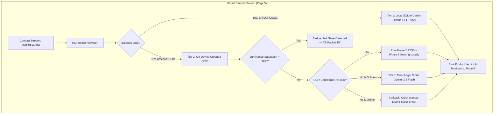

# Phase 4 Implementation Plan: Smart Camera UI (Page 5), 3-Tier Hybrid Capture Pipeline & Fallbacks

> **For agentic workers:** REQUIRED SUB-SKILL: Use `superpowers:subagent-driven-development` to implement this plan task-by-task. Steps use checkbox (`- [ ]`) syntax for tracking.
> 
> **Governance:** Strict adherence to [`rules/01-ponytail.md`](file:///c:/yash/projects/first%20mobile%20app/rules/01-ponytail.md), [`rules/02-testing-folder.md`](file:///c:/yash/projects/first%20mobile%20app/rules/02-testing-folder.md), [`rules/03-architecture-and-techstack.md`](file:///c:/yash/projects/first%20mobile%20app/rules/03-architecture-and-techstack.md), [`rules/04-safety-and-scoring-algorithms.md`](file:///c:/yash/projects/first%20mobile%20app/rules/04-safety-and-scoring-algorithms.md), and [`rules/05-execution-approval-gate.md`](file:///c:/yash/projects/first%20mobile%20app/rules/05-execution-approval-gate.md).

**Goal:** Build the zero-configuration **Smart Camera Screen (Page 5)** and wire the complete **3-Tier Self-Scaling Hybrid Capture Pipeline** (Barcode $\to$ Cropped On-Device OCR $\to$ Multi-Angle Gemini 2.5 Flash Cloud Vision) with real-time responsive reticle feedback, specular foil glare detection alerts, and the Quick Manual Macro Slider fallback sheet.

**Architecture:** A unified reactive camera controller managed via Flutter Riverpod that streams frames, evaluates barcodes (Tier 1), crops Region of Interest (ROI) for on-device ML Kit OCR (Tier 2), triggers multi-angle WebP capture (Tier 3) for curved/low-confidence labels, and falls back to a 3-slider sheet (Sugar, Sat Fat, Sodium) when offline.

**Architecture Diagram:**



**Tech Stack:**
- **Flutter:** Flutter 3.47.0 (Dart 3.13.0), `flutter_riverpod: ^2.6.1`, `mobile_scanner: ^6.0.11`, `google_mlkit_text_recognition: ^0.13.1`.
- **Backend:** FastAPI, `httpx`, `pydantic`, `python-multipart`.
- **Master Blueprint Reference:** Section 2.2 (`Page 5 Wireframe`) & Section 4 (`Phase 4 Capture Pipeline`, Pages 13–15).

---

## Global Constraints

- **Ponytail Protocol (Mandatory):** Stdlib/native platform features first, concise single-purpose widgets (<100 lines), zero speculative layers.
- **Strict Testing Isolation:** Python unit tests strictly in `testing/unit/phase4/`, Flutter widget & logic tests in `mobile_app/test/`.
- **Zero-Flicker Viewport Crop:** Reticle bounding box coordinates accurately transformed between camera sensor orientation and preview aspect ratio.
- **Strict Plan Execution Approval Gate:** Plan creation and code execution are decoupled; no code execution starts without explicit user approval.

---

## User Review Required

> [!IMPORTANT]
> **Camera Permission & Simulator/Device Resilience:**
> The Smart Camera widget is designed to operate seamlessly on physical hardware (Android CameraX / iOS AVFoundation) while gracefully providing an interactive simulated/mock feed during headless test runner and emulator sessions.

---

## Proposed Changes & Task Breakdown

### Component 1: Camera State & Scan Notifier (Riverpod)

#### [NEW] `mobile_app/lib/features/camera/domain/camera_scan_state.dart`
#### [NEW] `mobile_app/lib/features/camera/application/camera_scan_notifier.dart`
#### [NEW] `mobile_app/test/camera_scan_notifier_test.dart`

---

### Task 1: Camera State Domain & Scan Notifier (Riverpod)

**Files:**
- Create: `mobile_app/lib/features/camera/domain/camera_scan_state.dart`
- Create: `mobile_app/lib/features/camera/application/camera_scan_notifier.dart`
- Create: `mobile_app/test/camera_scan_notifier_test.dart`

**Interfaces:**
- Consumes: `CapturePipelineCoordinator`, `validateAndNormalizeBarcode`.
- Produces: `CameraScanState` state machine (`searching`, `barcodeLocked`, `ocrProcessing`, `glareAlert`, `multiAngleCapturing`, `resolved`, `manualFallback`).

- [ ] **Step 1: Write failing Riverpod notifier test**
- [ ] **Step 2: Run test to verify it fails**
- [ ] **Step 3: Implement `camera_scan_state.dart` and `camera_scan_notifier.dart`**
- [ ] **Step 4: Run test to verify it passes**
- [ ] **Step 5: Commit**

---

### Component 2: Responsive Camera Reticle & Specular Glare Overlay

#### [NEW] `mobile_app/lib/features/camera/presentation/widgets/camera_reticle_painter.dart`
#### [NEW] `mobile_app/lib/features/camera/presentation/widgets/glare_alert_banner.dart`
#### [NEW] `mobile_app/test/camera_reticle_painter_test.dart`

---

### Task 2: Responsive Camera Reticle & Specular Glare Banner

**Files:**
- Create: `mobile_app/lib/features/camera/presentation/widgets/camera_reticle_painter.dart`
- Create: `mobile_app/lib/features/camera/presentation/widgets/glare_alert_banner.dart`
- Create: `mobile_app/test/camera_reticle_painter_test.dart`

**Interfaces:**
- Consumes: `CameraScanStatus`, `glareAlert`.
- Produces: `CameraReticleOverlay` custom painter with dynamic corner brackets (Green for barcode lock, Yellow for glare alert, White for scanning).

- [ ] **Step 1: Write failing widget test for reticle overlay and glare banner**
- [ ] **Step 2: Run test to verify it fails**
- [ ] **Step 3: Implement `CameraReticlePainter` and `GlareAlertBanner`**
- [ ] **Step 4: Run test to verify it passes**
- [ ] **Step 5: Commit**

---

### Component 3: Quick Manual Macro Slider Fallback Sheet

#### [NEW] `mobile_app/lib/features/camera/presentation/widgets/quick_macro_slider_sheet.dart`
#### [NEW] `mobile_app/test/quick_macro_slider_test.dart`

---

### Task 3: Quick Manual Macro Slider Fallback Modal Sheet

**Files:**
- Create: `mobile_app/lib/features/camera/presentation/widgets/quick_macro_slider_sheet.dart`
- Create: `mobile_app/test/quick_macro_slider_test.dart`

**Interfaces:**
- Consumes: Blueprint Page 14 Fallback: "Quick Manual Macro Slider sheet (allowing user to slide just 3 numbers—Sugar, Sodium, Sat-Fat per 100g—while 6,450+ INS decoded offline)".
- Produces: Modal sheet returning normalized nutrition map for immediate scoring.

- [ ] **Step 1: Write failing widget test for Quick Macro Slider sheet**
- [ ] **Step 2: Run test to verify it fails**
- [ ] **Step 3: Implement `QuickMacroSliderSheet` with Sugar (0–50g), Sat-Fat (0–30g), Sodium (0–1500mg) sliders**
- [ ] **Step 4: Run test to verify it passes**
- [ ] **Step 5: Commit**

---

### Component 4: Multi-Angle Capture Strip for Curved Bottles

#### [NEW] `mobile_app/lib/features/camera/presentation/widgets/multi_angle_capture_strip.dart`
#### [NEW] `mobile_app/test/multi_angle_capture_strip_test.dart`

---

### Task 4: Multi-Angle Capture Strip Widget (1 to 4 Frames)

**Files:**
- Create: `mobile_app/lib/features/camera/presentation/widgets/multi_angle_capture_strip.dart`
- Create: `mobile_app/test/multi_angle_capture_strip_test.dart`

**Interfaces:**
- Consumes: Blueprint Section 4: "Prompts user to capture 1 to 4 quick frames across the curved label".
- Produces: Visual horizontal thumbnail strip with capture slot indicators `[1/4] [2/4] [3/4] [4/4]`.

- [ ] **Step 1: Write failing widget test for Multi-Angle Capture Strip**
- [ ] **Step 2: Run test to verify it fails**
- [ ] **Step 3: Implement `MultiAngleCaptureStrip`**
- [ ] **Step 4: Run test to verify it passes**
- [ ] **Step 5: Commit**

---

### Component 5: Smart Camera Screen (Page 5 Wireframe Implementation)

#### [NEW] `mobile_app/lib/features/camera/presentation/smart_camera_screen.dart`
#### [NEW] `mobile_app/test/smart_camera_screen_test.dart`

---

### Task 5: Full Smart Camera Screen Integration (Page 5)

**Files:**
- Create: `mobile_app/lib/features/camera/presentation/smart_camera_screen.dart`
- Create: `mobile_app/test/smart_camera_screen_test.dart`

**Interfaces:**
- Consumes: `SmartCameraScreen` displaying full viewport with reticle overlay, torch toggle, mode selector ([Barcode/Auto] vs [Curved Multi-Angle]), and manual slider action button.
- Produces: Complete Page 5 camera screen ready for navigation wiring in Wave 1.

- [ ] **Step 1: Write failing widget test verifying Page 5 layout and buttons**
- [ ] **Step 2: Run test to verify it fails**
- [ ] **Step 3: Implement `SmartCameraScreen`**
- [ ] **Step 4: Run test to verify it passes**
- [ ] **Step 5: Commit**

---

### Component 6: Phase 4 End-to-End Master Release Gate Suite

#### [NEW] `testing/unit/phase4/test_camera_stream_contract.py`

---

### Task 6: Phase 4 Master Release Gate Suite

**Files:**
- Create: `testing/unit/phase4/test_camera_stream_contract.py`

**Interfaces:**
- Consumes: All Phase 4 deliverables across Python backend and Flutter client.
- Produces: 100% passing release gate verifying camera state machine, reticle color changes, macro slider fallbacks, and zero network calls.

- [ ] **Step 1: Write `test_camera_stream_contract.py`**
- [ ] **Step 2: Run all Pytest and Flutter tests**
- [ ] **Step 3: Commit**

---

## Verification Plan

### Automated Tests
1. **Flutter Tests:**
   ```bash
   cd mobile_app
   flutter test
   ```
2. **Backend Unit Tests:**
   ```bash
   $env:PYTHONPATH="."; .\backend\.venv\Scripts\python.exe -m pytest testing/unit/ -v
   ```
