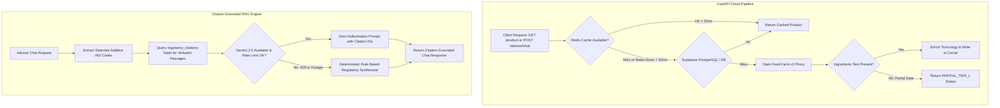

# Phase 5 Implementation Plan: FastAPI Backend, Supabase PostgreSQL, Redis Cache & Citation-Grounded RAG

> **For agentic workers:** REQUIRED SUB-SKILL: Use `superpowers:subagent-driven-development` to implement this plan task-by-task. Steps use checkbox (`- [ ]`) syntax for tracking.
> 
> **Governance:** Strict adherence to [`rules/01-ponytail.md`](file:///c:/yash/projects/first%20mobile%20app/rules/01-ponytail.md), [`rules/02-testing-folder.md`](file:///c:/yash/projects/first%20mobile%20app/rules/02-testing-folder.md), [`rules/03-architecture-and-techstack.md`](file:///c:/yash/projects/first%20mobile%20app/rules/03-architecture-and-techstack.md), [`rules/04-safety-and-scoring-algorithms.md`](file:///c:/yash/projects/first%20mobile%20app/rules/04-safety-and-scoring-algorithms.md), and [`rules/05-execution-approval-gate.md`](file:///c:/yash/projects/first%20mobile%20app/rules/05-execution-approval-gate.md).

**Goal:** Build the complete cloud infrastructure backend specified in Section 5 of the Master Blueprint:
1. **Multi-Layer Cache & Persistence:** Redis sub-15ms caching with graceful < 50ms fallback to Supabase PostgreSQL / SQLite.
2. **Open Food Facts Partial Handling:** Return `PARTIAL_TIER_1` status when product exists but ingredients are missing, seamlessly prompting Tier 2 OCR.
3. **Citation-Grounded RAG Advisor:** Route `POST /api/v1/advisor/chat` injecting active product JSON, user disease guardrails (Diabetes, Hypertension, Child-Safe), and verbatim regulatory citations.
4. **Zero-Hallucination Guardrails:** Prompt engineering enforcing `[Citation_ID]` tags on every toxicity claim.
5. **Deterministic Rule-Based Synthesizer (HTTP 429 Fallback):** Generates structured citation-backed advice without LLM dependency when rate-limited or offline.

**Architecture Diagram:**



**Tech Stack:**
- **FastAPI / Python 3.13:** `fastapi`, `httpx`, `pydantic`, `redis`, `supabase`, `google-genai`.
- **Database:** SQLite `regulatory_citations` + Supabase PostgreSQL schema.
- **Master Blueprint Reference:** Section 5 (`Phase 5 Backend & Citation RAG`, Pages 14–15).

---

## Global Constraints

- **Ponytail Protocol (Mandatory):** Pure minimal stdlib/native fallbacks, non-blocking connection timeouts (< 50ms), zero speculative bloat.
- **Strict Testing Isolation:** All test fixtures and mock responses strictly in `testing/unit/phase5/`.
- **Zero-Hallucination Citation Grounding:** Every additive claim MUST reference a verifiable citation ID from WHO, FSSAI, JECFA, or EFSA; NEVER fabricate safety evidence.

---

## User Review Required

> [!IMPORTANT]
> **API Key & Cloud Service Resilience:**
> The backend gracefully handles unconfigured or unreachable cloud keys (Supabase, Redis, Gemini) by auto-falling back to local SQLite citations, local product cache, and the deterministic rule-based advice synthesizer.

---

## Proposed Changes & Task Breakdown

### Component 1: Multi-Layer Redis & Supabase Resilience Layer

#### [NEW] `backend/services/cache_service.py`
#### [NEW] `backend/services/supabase_service.py`
#### [NEW] `testing/unit/phase5/test_cache_resilience.py`

---

### Task 1: Multi-Layer Cache Resilience & < 50ms Fallback

**Files:**
- Create: `backend/services/cache_service.py`
- Create: `backend/services/supabase_service.py`
- Create: `testing/unit/phase5/test_cache_resilience.py`

**Interfaces:**
- Consumes: Redis / Supabase connection configs.
- Produces: `get_cached_product(barcode)`, `set_cached_product(barcode, data)` with automatic local SQLite fallback if Redis is down.

- [ ] **Step 1: Write failing test for Redis connection drop fallback**
- [ ] **Step 2: Run test to verify it fails**
- [ ] **Step 3: Implement `cache_service.py` and `supabase_service.py`**
- [ ] **Step 4: Run test to verify it passes**
- [ ] **Step 5: Commit**

---

### Component 2: Partial Tier 1 Open Food Facts Handling

#### [MODIFY] `backend/api/products.py`
#### [NEW] `testing/unit/phase5/test_partial_tier1.py`

---

### Task 2: Partial Tier 1 Detection & Status Code Contract

**Files:**
- Modify: `backend/api/products.py`
- Create: `testing/unit/phase5/test_partial_tier1.py`

**Interfaces:**
- Consumes: Open Food Facts response where `product_name` and `nutriments` exist, but `ingredients_text` is empty.
- Produces: Response with `"status": "PARTIAL_TIER_1"` and pre-filled nutrition, directing client to run 0.3s Tier 2 OCR.

- [ ] **Step 1: Write failing test for partial Tier 1 response**
- [ ] **Step 2: Run test to verify it fails**
- [ ] **Step 3: Update `backend/api/products.py`**
- [ ] **Step 4: Run test to verify it passes**
- [ ] **Step 5: Commit**

---

### Component 3: Citation RAG Context Assembly & Regulatory Citations Query

#### [NEW] `backend/services/rag_service.py`
#### [NEW] `testing/unit/phase5/test_citation_rag.py`

---

### Task 3: Citation RAG Context Assembly & SQLite Query

**Files:**
- Create: `backend/services/rag_service.py`
- Create: `testing/unit/phase5/test_citation_rag.py`

**Interfaces:**
- Consumes: Product additives list + SQLite `regulatory_citations` table.
- Produces: Formatted prompt context with verbatim regulatory passages from WHO, FSSAI, JECFA, EFSA.

- [ ] **Step 1: Write failing test for regulatory citation retrieval**
- [ ] **Step 2: Run test to verify it fails**
- [ ] **Step 3: Implement `fetch_citations_for_additives` in `rag_service.py`**
- [ ] **Step 4: Run test to verify it passes**
- [ ] **Step 5: Commit**

---

### Component 4: Deterministic Rule-Based Regulatory Synthesizer (HTTP 429 Fallback)

#### [MODIFY] `backend/services/rag_service.py`
#### [NEW] `testing/unit/phase5/test_rule_based_synthesizer.py`

---

### Task 4: Deterministic Rule-Based Regulatory Advisor Synthesizer

**Files:**
- Modify: `backend/services/rag_service.py`
- Create: `testing/unit/phase5/test_rule_based_synthesizer.py`

**Interfaces:**
- Consumes: Blueprint Page 15 Fallback: "Rule-Based Regulatory Summary Synthesizer that assembles verified citations, disease guardrail flags, and body-weight ADI math without LLM generation".
- Produces: Structured, citation-backed advice dictionary.

- [ ] **Step 1: Write failing test for rule-based synthesizer**
- [ ] **Step 2: Run test to verify it fails**
- [ ] **Step 3: Implement `synthesize_rule_based_advice`**
- [ ] **Step 4: Run test to verify it passes**
- [ ] **Step 5: Commit**

---

### Component 5: Advisor Chat API Endpoint & Zero-Hallucination Guardrail

#### [NEW] `backend/api/advisor.py`
#### [MODIFY] `backend/main.py`
#### [NEW] `testing/unit/phase5/test_advisor_api.py`

---

### Task 5: Advisor Chat Endpoint (`POST /api/v1/advisor/chat`)

**Files:**
- Create: `backend/api/advisor.py`
- Modify: `backend/main.py`
- Create: `testing/unit/phase5/test_advisor_api.py`

**Interfaces:**
- Consumes: `POST /api/v1/advisor/chat` with `AdvisorChatRequest` (product, guardrails, message).
- Produces: Advisor chat response with verified citation tags and disease guardrail warnings.

- [ ] **Step 1: Write failing test for advisor chat endpoint**
- [ ] **Step 2: Run test to verify it fails**
- [ ] **Step 3: Implement `backend/api/advisor.py` and register router**
- [ ] **Step 4: Run test to verify it passes**
- [ ] **Step 5: Commit**

---

### Component 6: Phase 5 Master Release Gate Suite

#### [NEW] `testing/unit/phase5/test_phase5_gate.py`

---

### Task 6: Phase 5 Master Release Gate Suite

**Files:**
- Create: `testing/unit/phase5/test_phase5_gate.py`

**Interfaces:**
- Consumes: All Phase 5 backend deliverables.
- Produces: 100% passing test gate verifying cache fallback, partial Tier 1, citation RAG, rule-based synthesizer, and zero external network calls.

- [ ] **Step 1: Write `test_phase5_gate.py`**
- [ ] **Step 2: Run full project test suite across Phases 1–5**
- [ ] **Step 3: Commit**

---

## Verification Plan

### Automated Tests
```bash
$env:PYTHONPATH="."; .\backend\.venv\Scripts\python.exe -m pytest testing/unit/ -v
```
All tests across Phases 1–5 must pass in $< 2\text{s}$ with 0 network calls.
