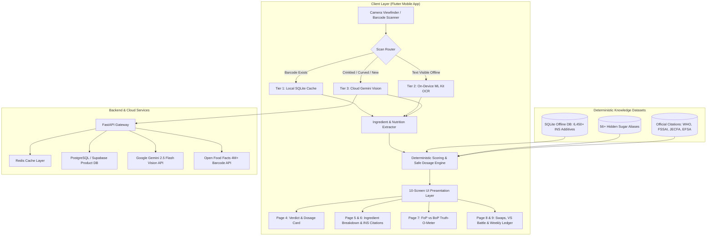

 # Smart Packaged Product Ingredient, Toxicology & Safe Dosage Scanner Implementation Plan

> **For agentic workers:** REQUIRED SUB-SKILL: Use `superpowers:subagent-driven-development` to implement this plan task-by-task. Steps use checkbox (`- [ ]`) syntax for tracking.

**Goal:** Build a cross-platform mobile application (Android & iOS in Flutter) and high-performance backend (Python FastAPI) that scans packaged food backside labels/barcodes, decodes 6,450+ chemical additives and hidden sugars offline, computes a deterministic 0–100 health score with a strict 39/100 toxic-additive cap, and prescribes exact safe consumption portions and frequencies scaled to user body weight.

**Architecture:** A 3-Tier hybrid scan routing pipeline (Tier 1: Instant local SQLite/Redis/Open Food Facts barcode lookup; Tier 2: On-device ML Kit OCR viewport extraction; Tier 3: Cloud Gemini 2.5 Flash Vision for multi-angle/curved packages with write-through cache). The application features a 10-screen Flutter UI powered by Riverpod and GoRouter, supported by a deterministic SQLite knowledge base, citation-grounded RAG, and an offline weekly consumption exposure ledger.

**Architecture Diagram:**

**Tech Stack:**
- **Mobile Frontend:** Flutter (Dart 3.x), Riverpod, GoRouter, `mobile_scanner`, `flutter_scalable_ocr`, Google ML Kit Text Recognition v2, `sqflite`/`drift` (FTS5), `flutter_tts`, `pdf`, `printing`.
- **Backend & Cloud:** Python 3.11+, FastAPI, PostgreSQL (Supabase), Redis, `google-genai` SDK (Gemini 2.5 Flash).
- **Specification:** [`PROJECT_SPECIFICATION.md`](file:///c:/yash/projects/exposure/PROJECT_SPECIFICATION.md)

---

## Global Constraints

- **Ponytail Protocol (Mandatory):** Follow [`rules/01-ponytail.md`](file:///c:/yash/projects/exposure/rules/01-ponytail.md). Every module must use the minimum working code. Stdlib and native platform features over dependencies; zero speculative abstractions; shortest working diffs.
- **Strict Testing Isolation:** Follow [`rules/02-testing-folder.md`](file:///c:/yash/projects/exposure/rules/02-testing-folder.md). All test scripts, throwaway probes, exploratory code, and fixtures must reside in [`testing/`](file:///c:/yash/projects/exposure/testing). Production source trees must remain 100% clean.
- **Deterministic 0–100 Health Score & Hard Red-Additive Cap:** Follow [`rules/04-safety-and-scoring-algorithms.md`](file:///c:/yash/projects/exposure/rules/04-safety-and-scoring-algorithms.md). Nutri-Score baseline calculation. Any product with a Red-tier toxic additive, synthetic azo dye, or trans fat **MUST be capped at 39/100 (Harmful — Avoid / Rare)**.
- **Precision Safe Consumption Dosage Formula:**
  $$\text{Base Safe Portion (g)} = \min\left(\frac{5\text{g}}{\text{Sugar\_per\_g}}, \frac{400\text{mg}}{\text{Sodium\_per\_g}}, \frac{4\text{g}}{\text{SatFat\_per\_g}}\right)$$
  $$\text{Adjusted Safe Portion (g)} = \text{Base Safe Portion} \times \left(\frac{\text{User\_Weight\_kg}}{65\text{ kg}}\right)$$
- **Zero-Hallucination Citation Requirement:** All health warnings must cite official passage IDs from FSSAI, WHO, JECFA, or EFSA. If none exist, output `NO_OFFICIAL_SOURCE`.

---

## User Review Required

> [!IMPORTANT]
> **No Application Code Phase Yet:** In accordance with the user's explicit directive ("strictly do not start with the coding part"), no production code or scaffolding will be initiated until this plan is reviewed and approved.
> 
> **Testing Strategy:** All validation runners, sandbox experiments, and mock fixtures will be stored strictly inside the [`testing/`](file:///c:/yash/projects/exposure/testing) directory.

---

## Project Phases & Detailed Tasks

```mermaid
gantt
    title Exposure Project Execution Roadmap
    dateFormat  X
    axisFormat %s
    section Phase 1: Core Engine
    Additive DB & INS Decoder (SQLite)      :p1_1, 0, 10
    Hidden Sugar Aggregator                 :p1_2, 10, 20
    Nutri-Score & Red-Additive Cap Engine   :p1_3, 20, 30
    Safe Dosage & Frequency Prescriber      :p1_4, 30, 40
    section Phase 2: Backend & AI
    FastAPI Service & Schemas               :p2_1, 40, 50
    Redis & Open Food Facts Tier 1 Cache    :p2_2, 50, 60
    Gemini 2.5 Flash Vision Tier 3 Pipeline :p2_3, 60, 70
    FoP vs BoP Claim Truth-O-Meter Engine   :p2_4, 70, 80
    section Phase 3: Flutter App Base
    Flutter Project & GoRouter Setup        :p3_1, 80, 90
    Riverpod Architecture & Offline SQLite  :p3_2, 90, 100
    Page 1: Onboarding & Weight Calibrator  :p3_3, 100, 110
    Page 2: Home Dashboard & Meter          :p3_4, 110, 120
    section Phase 4: Camera & OCR
    Tier 1 & 2 Live Camera Scanner View     :p4_1, 120, 130
    4-Angle Bottle Stitch & Vision Dispatch :p4_2, 130, 140
    section Phase 5: Result & Citations
    Page 4: Verdict & Serving Toggle        :p5_1, 140, 150
    Page 5 & 6: Breakdown & Citation Sheet  :p5_2, 150, 160
    Page 7: Front vs Back Truth-O-Meter     :p5_3, 160, 170
    section Phase 6: Swaps & Ledger
    Page 8: Clean Swaps & Quick-Commerce    :p6_1, 170, 180
    Page 9: VS Battle & Weekly Ledger       :p6_2, 180, 190
    Page 10: Scan History & Settings        :p6_3, 190, 200
    section Phase 7: Voice & PDF
    TTS Regional Voice Readouts             :p7_1, 200, 210
    1-Tap PDF Report Card Exporter          :p7_2, 210, 220
```

---

### Phase 1: Core Deterministic Engine & Additive Knowledge Base

#### Task 1.1: SQLite Additive Database & INS/E-Number Decoder
- **Files:**
  - Create: `backend/engine/additive_db.py`
  - Create: `backend/data/ins_additives.json`
  - Test: `testing/unit/test_additive_db.py`
- **Interfaces:**
  - `decode_additive(code_or_name: str) -> AdditiveInfo`
  - `extract_additives_from_text(conn, text: str) -> list[AdditiveInfo]`
  - Resolves subcodes (e.g., `INS 322(i)` $\to$ `INS 322`) and bracketed codes (`[INS 503(ii), 500(ii)]`).
  - Returns `chemical_name`, `category`, `toxicity_tier` (`green` | `amber` | `red`), `international_bans` (`list[str]`), and `jecfa_adi_mg_kg` (`float | None`).
- [ ] **Step 1: Write failing test in `testing/unit/test_additive_db.py`**
- [ ] **Step 2: Run test to verify failure**
- [ ] **Step 3: Implement minimal SQLite INS database builder, lookup, and text extractor**
- [ ] **Step 4: Verify test passes**
- [ ] **Step 5: Commit**

#### Task 1.2: Hidden Sugar & Sweetener Aggregator
- **Files:**
  - Create: `backend/engine/sugar_aggregator.py`
  - Create: `backend/data/sweetener_aliases.json`
  - Test: `testing/unit/test_sugar_aggregator.py`
- **Interfaces:**
  - `detect_sweeteners(ingredients_list_or_raw_text: list[str] | str) -> SweetenerClusterResult`
  - Detects if $\ge 2$ aliases exist from the 56+ alias list (Maltodextrin, Invert Syrup, Glucose Syrup, High-Fructose Corn Syrup, etc.).
  - Partitions into `caloric_sugars` and `intense_sweeteners` (Sucralose, Aspartame, Acesulfame K, Steviol Glycosides).
- [ ] **Step 1: Write failing test in `testing/unit/test_sugar_aggregator.py`**
- [ ] **Step 2: Run test to verify failure**
- [ ] **Step 3: Implement regex-based fast sweetener aggregator and classifier**
- [ ] **Step 4: Verify test passes**
- [ ] **Step 5: Commit**

#### Task 1.3: Nutri-Score & Red-Additive Cap Calculation Engine
- **Files:**
  - Create: `backend/engine/scoring_engine.py`
  - Test: `testing/unit/test_scoring_engine.py`
- **Interfaces:**
  - `calculate_health_score(nutrition: NutritionData, additives: list[AdditiveInfo]) -> HealthScoreResult`
  - Computes 0–100 score from Nutri-Score balance with safe `None`-tolerant numeric ingestion.
  - Applies strict cap: If any additive has `toxicity_tier == 'red'` or trans-fat > 0, score is clamped to maximum **39**.
- [ ] **Step 1: Write failing test in `testing/unit/test_scoring_engine.py`**
- [ ] **Step 2: Run test to verify failure**
- [ ] **Step 3: Implement mathematical Nutri-Score & NOVA cap logic**
- [ ] **Step 4: Verify test passes**
- [ ] **Step 5: Commit**

#### Task 1.4: Precision Safe Consumption Dosage & Frequency Engine
- **Files:**
  - Create: `backend/engine/dosage_engine.py`
  - Test: `testing/unit/test_dosage_engine.py`
- **Interfaces:**
  - `calculate_safe_dosage(nutrition: NutritionData, user_weight_kg: float, piece_weight_g: float | None, score: int, nova_group: int, has_red_additive: bool, detected_additives: list[dict] | None) -> SafeDosagePrescription`
  - Implements:
    $$\text{Base Portion} = \min(5 / \text{Sugar\_g}, 400\text{mg} / \text{Sodium\_mg}, 4 / \text{SatFat\_g})$$
    $$\text{Safe Portion} = \text{Base Portion} \times (\text{user\_weight\_kg} / 65)$$
  - Cross-checks additive JECFA ADI limits for sensitive body weights (e.g., 20kg child).
  - Translates grams to piece count if `piece_weight_g` is provided.
  - Assigns schedule: *Daily Safe*, *3–4x/Week*, *1–2x/Week*, or *Once a Month / Avoid*.
- [ ] **Step 1: Write failing test in `testing/unit/test_dosage_engine.py`**
- [ ] **Step 2: Run test to verify failure**
- [ ] **Step 3: Implement dosage calculation functions**
- [ ] **Step 4: Verify test passes**
- [ ] **Step 5: Commit**

---

### Phase 2: FastAPI Gateway, Redis Caching & Cloud Gemini Vision

#### Task 2.1: FastAPI Service & Data Contracts
- **Files:**
  - Create: `backend/main.py`
  - Create: `backend/models/schemas.py`
  - Test: `testing/integration/test_api_endpoints.py`
- **Interfaces:**
  - `POST /api/v1/scan/barcode`
  - `POST /api/v1/scan/ocr`
  - `POST /api/v1/scan/vision`
- [ ] **Step 1: Write failing test in `testing/integration/test_api_endpoints.py`**
- [ ] **Step 2: Run test to verify failure**
- [ ] **Step 3: Implement minimal FastAPI app with Pydantic request/response schemas**
- [ ] **Step 4: Verify test passes**
- [ ] **Step 5: Commit**

#### Task 2.2: Tier 1 Barcode Routing & Redis/Open Food Facts Caching
- **Files:**
  - Create: `backend/services/tier1_service.py`
  - Test: `testing/integration/test_tier1_service.py`
- **Interfaces:**
  - `lookup_barcode(barcode: str) -> ProductResult | None`
  - Checks Redis -> Supabase -> Open Food Facts API -> saves to Redis.
- [ ] **Step 1: Write failing mock test for Open Food Facts barcode lookup**
- [ ] **Step 2: Run test to verify failure**
- [ ] **Step 3: Implement Redis cache check + Open Food Facts fallback with auto-write**
- [ ] **Step 4: Verify test passes**
- [ ] **Step 5: Commit**

#### Task 2.3: Tier 3 Cloud Gemini 2.5 Flash Vision Pipeline & Prompt Grounding
- **Files:**
  - Create: `backend/services/gemini_vision_service.py`
  - Create: `backend/prompts/label_extraction_prompt.py`
  - Test: `testing/integration/test_gemini_vision.py`
- **Interfaces:**
  - `extract_product_from_images(image_bytes_list: list[bytes]) -> ExtractedProductJSON`
  - Formats prompt instructing Gemini 2.5 Flash to return strictly typed JSON with ingredient list, nutrition table per 100g and per serving, and front-of-pack claims.
- [ ] **Step 1: Write test with mock Gemini 2.5 Flash response parsing**
- [ ] **Step 2: Run test to verify failure**
- [ ] **Step 3: Implement Gemini API wrapper with `google-genai` SDK and JSON schema mode**
- [ ] **Step 4: Verify test passes**
- [ ] **Step 5: Commit**

#### Task 2.4: Front-of-Pack vs Back-of-Pack "Truth-O-Meter" Claim Auditor
- **Files:**
  - Create: `backend/engine/truth_meter.py`
  - Test: `testing/unit/test_truth_meter.py`
- **Interfaces:**
  - `audit_claims(front_claims: list[str], back_ingredients: list[str], nutrition: NutritionData) -> list[ClaimAuditResult]`
  - Detects misleading claims like "Multigrain" with < 5% millets, or "No Added Sugar" with concentrated fruit puree / maltodextrin.
- [ ] **Step 1: Write failing test in `testing/unit/test_truth_meter.py`**
- [ ] **Step 2: Run test to verify failure**
- [ ] **Step 3: Implement claim fact-checking logic**
- [ ] **Step 4: Verify test passes**
- [ ] **Step 5: Commit**

---

### Phase 3: Flutter Mobile Foundation & Navigation

#### Task 3.1: Flutter Project Setup & GoRouter Configuration
- **Files:**
  - Create: `mobile/lib/main.dart`
  - Create: `mobile/lib/core/routing/app_router.dart`
  - Create: `mobile/lib/core/theme/app_theme.dart`
  - Test: `testing/scratch/verify_flutter_routes.dart`
- **Interfaces:**
  - Setup 10-screen route hierarchy with 4 bottom tabs: Home, Scan, Compare/Ledger, History/Settings.
- [ ] **Step 1: Write route registry test checking all 10 screen paths**
- [ ] **Step 2: Implement Riverpod-driven GoRouter configuration**
- [ ] **Step 3: Add dark/light modern typography theme**
- [ ] **Step 4: Commit**

#### Task 3.2: Page 1 — Onboarding & Body-Weight Setup Screen
- **Files:**
  - Create: `mobile/lib/features/onboarding/presentation/onboarding_screen.dart`
  - Create: `mobile/lib/features/user_profile/state/user_profile_provider.dart`
- **UI Components:**
  - 3-slide visual walkthrough.
  - Interactive Body-Weight slider (20kg to 120kg, default 65kg) and Age picker.
  - Regional Language selector (English, Hindi, Marathi, Tamil, Telugu).
  - "Continue Offline Without Account" button.
- [ ] **Step 1: Implement user profile state notifier with SharedPreferences persistence**
- [ ] **Step 2: Build responsive Onboarding UI with smooth slider**
- [ ] **Step 3: Commit**

#### Task 3.3: Page 2 — Home Dashboard Screen
- **Files:**
  - Create: `mobile/lib/features/dashboard/presentation/dashboard_screen.dart`
  - Create: `mobile/lib/features/dashboard/presentation/widgets/exposure_meter_card.dart`
  - Create: `mobile/lib/features/dashboard/presentation/widgets/recent_scans_carousel.dart`
- **UI Components:**
  - Hero "Scan Product Now" CTA card.
  - Today's & Weekly Additive/Sugar Exposure Meter (progress gauge).
  - Horizontal carousel of last 50 scans.
  - "Fact of the Day" educational banner.
- [ ] **Step 1: Build exposure meter widget calculating weekly sugar/sodium percentage**
- [ ] **Step 2: Connect offline SQLite recent scans stream**
- [ ] **Step 3: Commit**

---

### Phase 4: 3-Tier Camera & Scanner Integration

#### Task 4.1: Page 3 — Zero-Config Intelligent Smart Camera Viewfinder
- **Files:**
  - Create: `mobile/lib/features/scanner/presentation/camera_viewfinder_screen.dart`
  - Create: `mobile/lib/features/scanner/presentation/widgets/roi_bounding_box.dart`
  - Create: `mobile/lib/features/scanner/presentation/widgets/auto_sense_badge.dart`
- **UI Components:**
  - Live camera feed with adaptive `flutter_scalable_ocr` ROI box.
  - Zero Manual Mode Switches: Intelligent automated detection of flat pouches, curved cylindrical bottles, reflective foil/gloss, and front vs back labels.
  - Real-Time AI Auto-Sense Badge: Displays detected context (e.g., "✨ Auto-Detected: Curved Bottle · Compensating Distortion" or "✨ Foil Glare · Auto-Adjusting Torch").
  - Gallery picker button, 1x/2x zoom toggle, and central glowing shutter button.
- [ ] **Step 1: Build Camera Viewfinder with ROI overlay**
- [ ] **Step 2: Integrate `mobile_scanner` for 30 FPS barcode detection**
- [ ] **Step 3: Integrate on-device ML Kit OCR inside ROI box**
- [ ] **Step 4: Commit**

#### Task 4.2: 4-Angle Stitching & Tier 3 Cloud Gemini Dispatcher
- **Files:**
  - Create: `mobile/lib/features/scanner/data/scan_coordinator.dart`
- **Logic:**
  - Coordinates fallback from Tier 1 -> Tier 2 -> Tier 3.
  - If curved bottle mode is selected, collects up to 4 captures and uploads to `/api/v1/scan/vision`.
- [ ] **Step 1: Implement scan coordinator with fallback timeout logic**
- [ ] **Step 2: Commit**

---

### Phase 5: Core Result Screens, Ingredient Citations & Truth-O-Meter

#### Task 5.1: Page 4 — Master Product Verdict & Safe Dosage Report
- **Files:**
  - Create: `mobile/lib/features/results/presentation/verdict_report_screen.dart`
  - Create: `mobile/lib/features/results/presentation/widgets/circular_score_gauge.dart`
  - Create: `mobile/lib/features/results/presentation/widgets/dosage_prescription_card.dart`
- **UI Components:**
  - Circular 0–100 Health Score animated gauge (Green/Amber/Red).
  - NOVA Group (1–4) Badge and Verdict Banner (*Useful / Regular*, *Moderate*, *Harmful / Avoid*).
  - Dynamic Serving Multiplier Toggle: "1 Label Serving (20g)" vs "Whole Packet (90g)".
  - Safe Consumption Dosage Card: Exact safe grams & pieces (e.g., "Max 22g / 3 biscuits") + Frequency Badge.
  - "Log to My Weekly Intake" CTA.
- [ ] **Step 1: Build animated Circular Score Gauge with color interpolation**
- [ ] **Step 2: Build serving toggle that dynamically updates calories, sugar, and fat values**
- [ ] **Step 3: Build Safe Consumption Dosage Prescription Card**
- [ ] **Step 4: Commit**

#### Task 5.2: Page 5 & Page 6 — Ingredient Breakdown & INS Citation Bottom Sheet
- **Files:**
  - Create: `mobile/lib/features/results/presentation/ingredient_breakdown_tab.dart`
  - Create: `mobile/lib/features/results/presentation/widgets/ingredient_pill.dart`
  - Create: `mobile/lib/features/results/presentation/bottom_sheets/ingredient_deep_dive_sheet.dart`
- **UI Components:**
  - Split-Sugar Warning Banner.
  - Interactive Ingredient list with Green/Amber/Red color pills and International Ban tags.
  - Modal Bottom Sheet with Chemical name, function, health impacts, JECFA ADI, and verified citation passage quote.
- [ ] **Step 1: Build Split-Sugar cluster warning banner**
- [ ] **Step 2: Build interactive ingredient tile displaying toxicity status and ban tags**
- [ ] **Step 3: Build Modal Bottom Sheet for single ingredient deep-dive with citation verification**
- [ ] **Step 4: Commit**

#### Task 5.3: Page 7 — Front-of-Pack vs Back-of-Pack "Truth-O-Meter"
- **Files:**
  - Create: `mobile/lib/features/results/presentation/truth_meter_screen.dart`
  - Create: `mobile/lib/features/results/presentation/widgets/claim_audit_card.dart`
- **UI Components:**
  - Side-by-side thumbnail of Front Box vs Back Label.
  - Claim Fact-Check cards (Front Claim vs Back Reality vs Truth Verdict).
- [ ] **Step 1: Build side-by-side photo comparison view**
- [ ] **Step 2: Build Claim Audit Card with callouts**
- [ ] **Step 3: Commit**

---

### Phase 6: Swaps, VS Battle Mode & Weekly Consumption Ledger

#### Task 6.1: Page 8 — Smart Healthier Swaps & Quick-Commerce Integration
- **Files:**
  - Create: `mobile/lib/features/swaps/presentation/healthier_swaps_screen.dart`
  - Create: `mobile/lib/features/swaps/presentation/widgets/quick_commerce_button.dart`
- **UI Components:**
  - Top 3 healthier Indian alternatives in the category.
  - Score improvement diff banner (e.g., "+48 Health Points, 0 Red Additives").
  - 1-Tap deep links into Blinkit, Zepto, Swiggy Instamart, and BigBasket.
- [ ] **Step 1: Build category alternative ranking provider**
- [ ] **Step 2: Implement deep link URL generator for Blinkit, Zepto, Swiggy, and BigBasket**
- [ ] **Step 3: Commit**

#### Task 6.2: Page 9 — Side-by-Side "VS" Battle Mode & Weekly Ledger
- **Files:**
  - Create: `mobile/lib/features/compare/presentation/battle_and_ledger_screen.dart`
  - Create: `mobile/lib/features/compare/presentation/widgets/vs_battle_view.dart`
  - Create: `mobile/lib/features/compare/presentation/widgets/weekly_ledger_chart.dart`
- **UI Components:**
  - Sub-Tab A: Split screen comparing Product A vs Product B across Score, Sugar, Sodium, NOVA, Additives, and Safe Dosage, crowning a Winner Badge.
  - Sub-Tab B: Weekly Consumption Ledger bar chart tracking cumulative sugar, sodium, and additive exposure.
- [ ] **Step 1: Build split-screen comparison widget with winner calculation**
- [ ] **Step 2: Build weekly intake chart with safe upper ceiling threshold line**
- [ ] **Step 3: Commit**

#### Task 6.3: Page 10 — Offline Scan History, Bookmarks & Settings
- **Files:**
  - Create: `mobile/lib/features/settings/presentation/history_and_settings_screen.dart`
  - Create: `mobile/lib/features/history/data/offline_history_repository.dart`
- **UI Components:**
  - Searchable offline history (last 50 scans in local SQLite).
  - "Safe Favorites" (Green list) and "Do Not Buy" (Red list) tabs.
  - Settings: Body weight editor, voice language selector, dark/light toggle, and 7-day summary PDF export.
- [ ] **Step 1: Implement SQLite history repository with search and filter queries**
- [ ] **Step 2: Build settings screen with user preference controls**
- [ ] **Step 3: Commit**

---

### Phase 7: Regional Voice TTS & 1-Tap PDF Report Export

#### Task 7.1: Indian Regional Language TTS Voice Readouts
- **Files:**
  - Create: `mobile/lib/features/accessibility/voice_tts_service.dart`
- **Logic:**
  - Generates clear spoken health summary in Hindi, Marathi, Tamil, Telugu, and English.
- [ ] **Step 1: Implement `flutter_tts` wrapper with regional language selection**
- [ ] **Step 2: Commit**

#### Task 7.2: 1-Tap Shareable PDF Product Report Card
- **Files:**
  - Create: `mobile/lib/features/export/pdf_export_service.dart`
- **Logic:**
  - Exports clean 1-page PDF summarizing Health Score, Red Additives, Ingredient Breakdown, Safe Dosage, and Citations.
- [ ] **Step 1: Implement PDF generator using `pdf` and `printing` packages**
- [ ] **Step 2: Commit**

---

## Verification Plan

### Automated Tests (Executed strictly in `testing/`)
- **Unit Tests:**
  - `python -m pytest testing/unit/ -v` (Verifies additive decoding, sweetener clustering, Nutri-Score calculation, Red-additive 39-point cap, and dosage scaling).
- **Integration Tests:**
  - `python -m pytest testing/integration/ -v` (Verifies FastAPI endpoints, Redis caching, Open Food Facts fallback, and Gemini Vision JSON parsing).
- **Mobile Routing & State Tests:**
  - `flutter test testing/unit/` (Validates Riverpod providers, dosage conversions, and GoRouter navigation).

### Manual Verification
1. **Barcode Scan (Tier 1):** Scan a known Indian barcode (e.g., Maggi Noodles or Parle-G); verify instant (<0.2s) score and safe dosage computation.
2. **Offline Label OCR (Tier 2):** Disconnect internet, point camera at backside ingredient box; verify ML Kit recognizes text and decodes INS numbers locally.
3. **Curved / Crinkled Vision (Tier 3):** Capture shiny or curved bottle label across multiple angles; verify Gemini 2.5 Flash extracts JSON and auto-populates Tier 1 cache.
4. **Red-Additive Cap Check:** Scan a biscuit containing `INS 102` (Tartrazine); verify score cannot exceed 39/100 despite fiber/protein claims.
5. **Dosage Scaling Check:** Change body weight from 65kg to 20kg in Settings; verify safe dosage pieces/grams immediately reduce proportionally.
